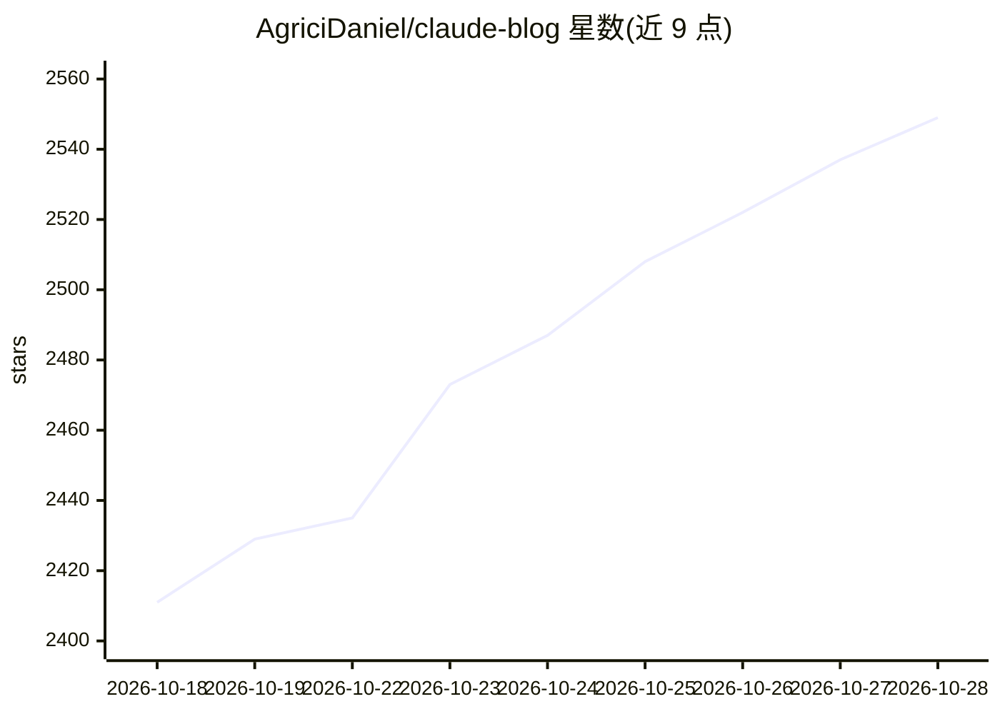

# AgriciDaniel/claude-blog

⭐ 2,563 · Python · MIT · 推送 2026-10-14 · [GitHub](https://github.com/AgriciDaniel/claude-blog) · [官网](skool.com/ai-marketing-hub-pro) · 个人维护

**面向 Claude Code 的博客写作与 SEO 优化技能套件**

claude-blog 是运行于 Claude Code 的博客内容技能套件：1 个编排器 + 31 个子技能 + 30 个 /blog 命令 + 5 个专用 agent，覆盖选题策略、写作、改写、SEO 校验、JSON-LD schema、多语言发布、音频朗读与内容衰退检测。核心机制为 5 关交付契约：每篇文章按 100 分评分，低于 90 分阻断交付，最多迭代 3 次；每篇产出 markdown/HTML/PDF/截图等工件。MIT 许可，需 Python 3.11+，面向个人博主、营销团队与 Claude Code 技能开发者。注意：v1.9.0 交付契约等版本描述与 v2.3.1 并存。

## 筛选速览

| 维度 | 判定 | 备注 |
|---|---|---|
| AI 角色 | `ai-native` | 本体是模型或模型工具 |
| 许可风险 | `permissive` | MIT |
| 部署形态 | `library` | 以包/库形式分发 |
| 模型依赖 | locked-api |  |
| 硬件要求 | — | 无带数字的原话,不猜 |
| 安装摩擦 | `low` | 无编译、无系统依赖或容器化 |
| 成熟度 | — | 结构信号不足 |

## 能力要点

- 32 个技能目录（1 编排器 + 31 子技能）、30 个 /blog 命令、5 个专用 agent
- 5 关交付契约：100 分评分制，低于 90 分阻断交付，最多迭代 3 次
- 每篇产出完整工件包：md/HTML/PDF/hero 图/3 视口截图/review/preflight 报告
- AI 引用就绪启发式评分（AI Overview/Perplexity/ChatGPT 视角，0-100 非校准）

## 适用场景

- 我作为个人博主想批量产出带 SEO 与 schema 的文章
- 营销团队跨品牌、多语言跑一致的多文章工作流
- 审计已有博客的质量并检测关键词蚕食与内容衰退
- 研究分层 Agent Skills 架构的 Claude Code 技能开发者

## 场景标签

`AI 写作` · 领域:内容生成

## 证据(README 行号)

> L17: **claude-blog is a Claude Code skill suite that writes, optimizes, audits, localizes, and refreshes blog content at
> L42: Current v2.3.1 shape: **32 skill directories = 1 orchestrator + 31 sub-skills; 30 user-facing /blog commands (`blog

## 星数曲线

2026-10-18 2,411 → 2026-10-28 2,549（+138）

---
*卡片 v1 · prompt 1.4 · 生成 2026-10-21 · 置信度 mid · 依据 README sha `b1d1370ee121` · [字段定义](../../DATASET.md)*
