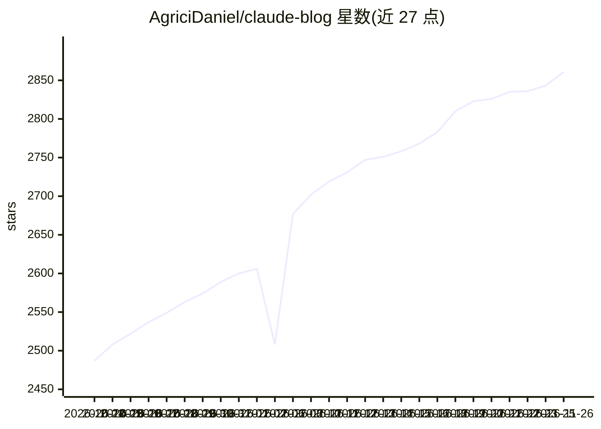

# AgriciDaniel/claude-blog

⭐ 2,861 · Python · MIT · 推送 2026-11-03 · [GitHub](https://github.com/AgriciDaniel/claude-blog) · [官网](skool.com/ai-marketing-hub-pro) · 个人维护

**Claude Code 插件：调研来源并生成经审校打分的博客文章**

以 Claude Code 插件形式分发的博客写作工具集：32 个 skills、5 个专职 agent、30 条 /blog 命令。输入主题后执行调研（分层引用来源并带日期）、写作、SEO 检查、独立 reviewer 百分制打分（低于 90 分或有 P0 问题即阻断），通过全部五道交付门后才输出成品，产物含 Markdown、HTML、PDF、hero 图与多尺寸截图。支持多语言本地化与 hreflang、/blog factcheck 逐条核验引用页、适配 Next.js/Astro/Hugo 等多种发布平台。需 Claude Code 与 Python 3.11+，渲染与截图依赖可选的 presentation extra。

## 筛选速览

| 维度 | 判定 | 备注 |
|---|---|---|
| AI 角色 | `ai-native` | 本体是模型或模型工具 |
| 许可风险 | `permissive` | MIT |
| 部署形态 | `library` | 以包/库形式分发 |
| 模型依赖 | — | README 未给出锁定关系 |
| 硬件要求 | — | 无带数字的原话,不猜 |
| 安装摩擦 | `low` | 无编译、无系统依赖或容器化 |
| 成熟度 | — | 结构信号不足 |

## 能力要点

- 5 个专职 agent 分工：researcher 是唯一可联网的，仅 writer/translator 可改文件
- reviewer 百分制打分并可阻断交付（<90 分或 P0 即拦截）
- /blog factcheck 抓取每条引用页面核验声明是否存在于原文
- 30 条命令覆盖策略、选题聚类、审计、翻译本地化、图像与音频生成

## 适用场景

- 给一个主题一句话生成一篇带来源和评分的博客文章
- 内容团队按统一流程对每篇文章打分、溯源与 SEO 检查
- 把文章翻译本地化成多语言版本并加 hreflang
- 用 /blog audit 检查整个博客目录的健康状况

## 场景标签

`AI 写作` · 领域:内容生成

## 证据(README 行号)

> L5:  Free, open-source AI blog writer for Claude Code.
> L24: **Claude Blog is a free blog writing skill for Claude Code.** Give it a topic and it researches current sources, wr
> L34: Claude Blog is built from 32 skills and 5 specialist agents, with 30 `/blog` commands for everything around the pos

## 星数曲线

2026-10-24 2,487 → 2026-11-26 2,861（+374）

---
*卡片 v1 · prompt 1.4 · 生成 2026-11-23 · 置信度 mid · 依据 README sha `526a6dc430a2` · [字段定义](../../DATASET.md)*
