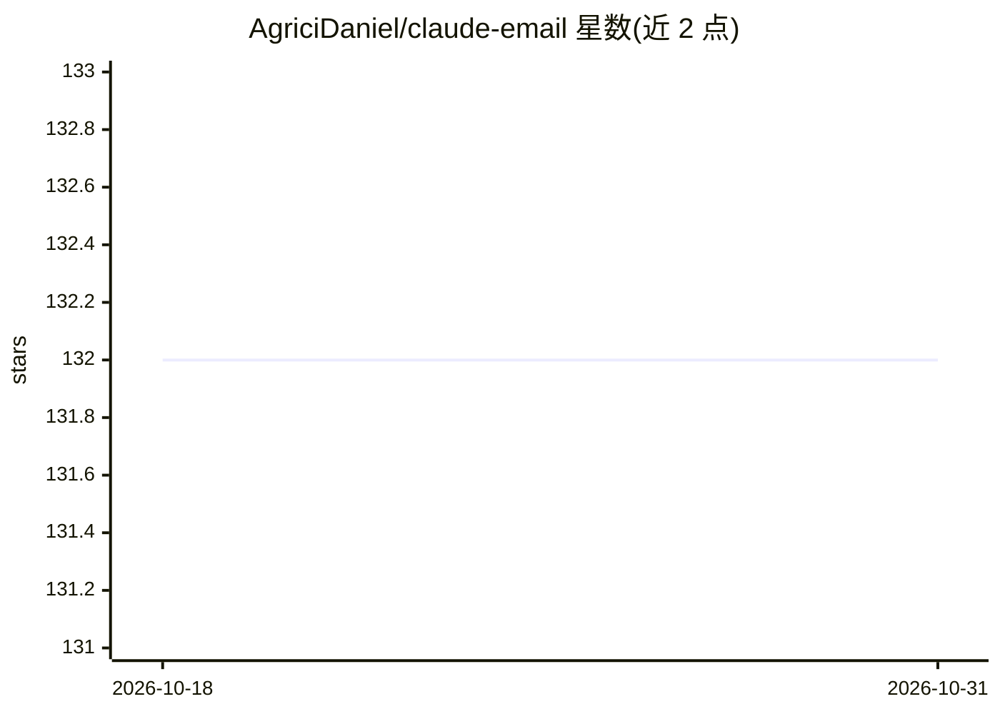

# AgriciDaniel/claude-email

⭐ 132 · Python · MIT · 推送 2026-05-23 · [GitHub](https://github.com/AgriciDaniel/claude-email) · [官网](https://www.skool.com/ai-marketing-hub-pro/) · 个人维护

**面向 Claude Code 的邮件管理与营销技能包（6 子技能/4 agent）**

以 Claude Code Agent Skills 形式提供的邮件工作流技能包：包含收件箱分诊（重要性评分、智能标签、回复建议）、基于 PAS/AIDA 等文案框架的邮件撰写、发送前 0-100 质量评分、SPF/DKIM/DMARC 送达性审计、自动化序列设计与 90 天营销策略规划。通过 Gmail/Outlook MCP 读取邮件（收件箱功能必需，其余可独立运行），首次运行生成 email-profile.md 用户画像供各子技能适配。提供 curl/PowerShell 安装脚本与手动安装路径。

## 筛选速览

| 维度 | 判定 | 备注 |
|---|---|---|
| AI 角色 | `ai-ecosystem` | LLM/agent 周边工具 |
| 许可风险 | `permissive` | MIT |
| 部署形态 | `None` |  |
| 模型依赖 | locked-api |  |
| 硬件要求 | — | 无带数字的原话,不猜 |
| 安装摩擦 | `low` | 无编译、无系统依赖或容器化 |
| 成熟度 | — | 结构信号不足 |

## 能力要点

- 收件箱分诊：AI 重要性评分、智能标签、回复建议（经 Gmail/Outlook MCP）
- 0-100 邮件质量评分（清晰度/专业度/CTA/语气/技术质量）
- SPF/DKIM/DMARC 校验与 Google/Yahoo/Microsoft 2024-2026 批量发送合规审计
- email-profile.md 用户画像系统，各子技能据此适配建议

## 适用场景

- 在 Claude Code 中对 Gmail/Outlook 收件箱做分诊与回复建议
- 撰写营销邮件并在发送前获得质量评分与改进建议
- 审计自有域名送达性配置与合规状态
- 设计欢迎/培育/召回等自动化邮件序列

## 场景标签

`AI 写作` · 领域:内容生成

## 证据(README 行号)

> L3: # Claude Email — AI-Powered Email Management and Marketing
> L5: > Professional email management, deliverability optimization, and marketing strategy powered by Claude Code
> L65: - **Claude Code CLI** (latest version)

## 星数曲线

2026-10-18 132 → 2026-10-31 132（+0）

---
*卡片 v1 · prompt 1.4 · 生成 2026-10-22 · 置信度 high · 依据 README sha `f3174325bc38` · [字段定义](../../DATASET.md)*
