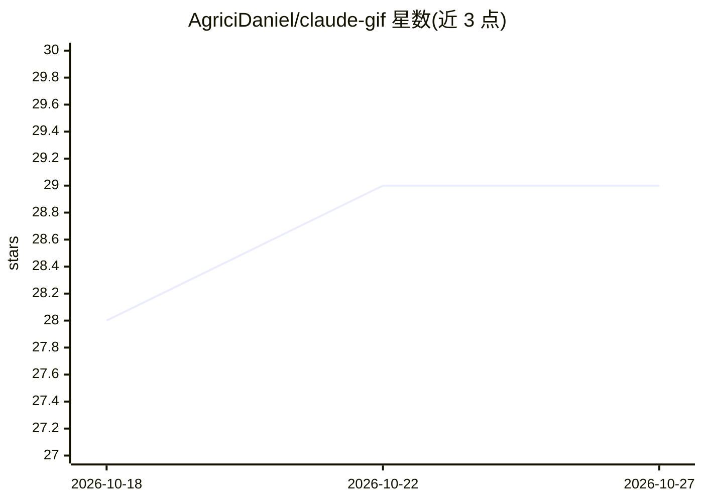

# AgriciDaniel/claude-gif

⭐ 29 · Python · MIT · 推送 2026-04-10 · [GitHub](https://github.com/AgriciDaniel/claude-gif) · [官网](https://agricidaniel.com) · 个人维护

**Claude Code 的 GIF 生成技能：6 条管线制作与优化 GIF**

面向 Claude Code 用户的 GIF 制作技能（skill），提供 6 条生成管线：Remotion 程序化动画、Veo 3.1 AI 视频转 GIF（约 $0.60-$4.00/段）、Playwright 渲染 SVG 为透明 GIF、FFmpeg 两遍调色板转换、图片序列合成、Gemini/FLUX.2 AI 帧序列。附带 5 个平台尺寸预设、完美循环评估、多策略压缩与编辑命令。必需依赖为 FFmpeg 6.0+ 与 Python 3.10+（Pillow/numpy），其余按管线可选；通过 install.sh 或 curl 一键脚本安装，并在 Claude Code 中以 /gif 命令调用。

## 筛选速览

| 维度 | 判定 | 备注 |
|---|---|---|
| AI 角色 | `ai-ecosystem` | LLM/agent 周边工具 |
| 许可风险 | `permissive` | MIT |
| 部署形态 | `None` |  |
| 模型依赖 | — | README 未给出锁定关系 |
| 硬件要求 | — | 无带数字的原话,不猜 |
| 安装摩擦 | `medium` | 含编译或系统依赖之一 |
| 成熟度 | — | 结构信号不足 |

## 能力要点

- 6 条生成管线覆盖 AI 视频、程序化动画、SVG、视频转换等来源
- 两遍调色板优化、dithering 控制、平台目标尺寸自动迭代压缩
- 5 个平台预设（discord/slack/twitter/web/hq）
- MAE 评分评估 GIF 完美循环质量

## 适用场景

- 在 Claude Code 里一句话生成产品演示或循环动图
- 把录屏、视频或 SVG 图标转成平台尺寸合规的 GIF
- 对已有 GIF 做压缩、变速、倒放、裁剪等编辑

## 场景标签

`视频生成` `图像视频处理` · 领域:内容生成

## 证据(README 行号)

> L1: # Claude GIF - Ultimate GIF Creator Skill for Claude Code
> L5: Claude Code Skill
> L49: |`/gif`|Interactive mode - detects intent, routes to sub-skill|

## 星数曲线

2026-10-18 28 → 2026-10-27 29（+1）

---
*卡片 v1 · prompt 1.4 · 生成 2026-10-26 · 置信度 high · 依据 README sha `107daf8460ec` · [字段定义](../../DATASET.md)*
