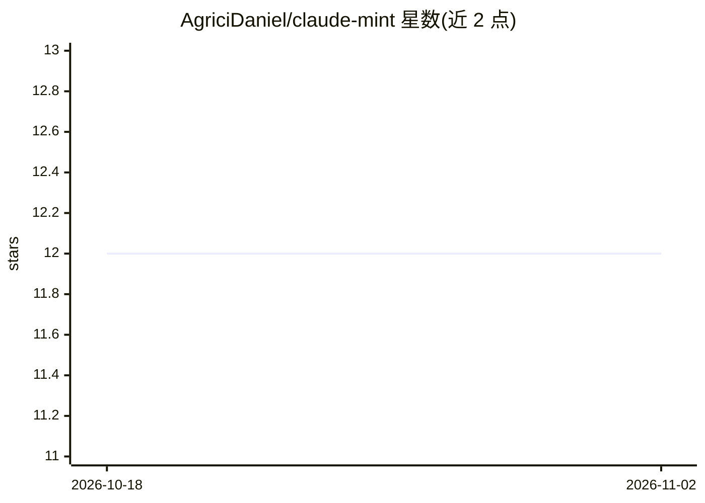

# AgriciDaniel/claude-mint

⭐ 12 · Shell · MIT · 推送 2026-04-10 · [GitHub](https://github.com/AgriciDaniel/claude-mint) · [官网](https://agricidaniel.com) · 个人维护

**面向 Linux Mint/Cinnamon 的 Claude Code 系统助手技能**

为 Claude Code 提供的技能包（SKILL.md + 安装脚本）：部署到 ~/.claude/ 后通过 /mint 命令路由，使 Claude Code 获得 Linux Mint 系统知识，覆盖健康报告、安全审计、mintupdate-cli 安全更新、NVIDIA/AMD PRIME GPU 切换、Cinnamon 桌面定制、Timeshift 快照与故障排查。安装时自动生成 CLAUDE.md 系统档案，硬件或内核变更后可用脚本重新生成。由 stellar-claude（Pop!_OS 版）适配而来，要求 Linux Mint 21.x/22.x Cinnamon、Node.js 与 Claude Code。

## 筛选速览

| 维度 | 判定 | 备注 |
|---|---|---|
| AI 角色 | `ai-ecosystem` | LLM/agent 周边工具 |
| 许可风险 | `permissive` | MIT |
| 部署形态 | `None` |  |
| 模型依赖 | — | README 未给出锁定关系 |
| 硬件要求 | — | 无带数字的原话,不猜 |
| 安装摩擦 | `low` | 无编译、无系统依赖或容器化 |
| 成熟度 | — | 结构信号不足 |

## 能力要点

- /mint 命令路由至 10 个子命令（status/security/update/gpu/backup 等）
- 安装时生成 CLAUDE.md 硬件与软件系统档案，变更后可重新生成
- Mint 专属工具链知识：mintupdate-cli、mintdrivers、Timeshift、prime-select
- 支持 NVIDIA/AMD/Intel 多种 GPU 配置的 PRIME 切换

## 适用场景

- 让 Claude Code 直接诊断和修复 Linux Mint 系统问题
- 通过对话执行安全审计与安全更新
- 管理 NVIDIA 混合显卡的 PRIME 模式切换

## 场景标签

`编码 Agent` `网络安全` · 领域:编码与开发

## 证据(README 行号)

> L8: An intelligent system assistant for **Linux Mint Cinnamon** — powered by Claude Code with directive-based workflows 
> L28: The `/mint` command gives Claude Code deep knowledge about your Linux Mint system:
> L59: ├── skills/mint/SKILL.md         ← Main skill file (/mint command)

## 星数曲线

2026-10-18 12 → 2026-11-02 12（+0）

---
*卡片 v1 · prompt 1.4 · 生成 2026-11-01 · 置信度 high · 依据 README sha `6ba183e65469` · [字段定义](../../DATASET.md)*
