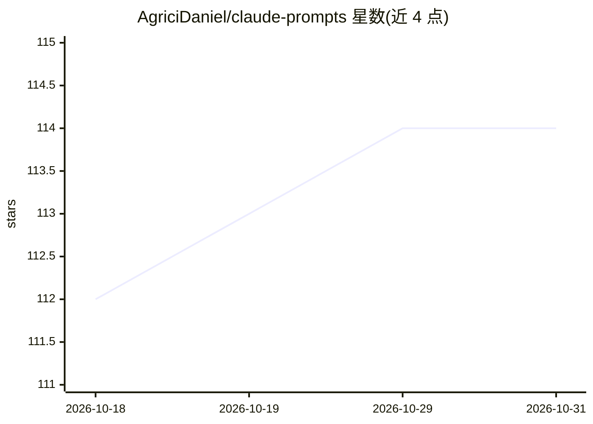

# AgriciDaniel/claude-prompts

⭐ 114 · Python · MIT · 推送 2026-04-10 · [GitHub](https://github.com/AgriciDaniel/claude-prompts) · [官网](https://www.skool.com/ai-marketing-hub-pro/) · 个人维护

**面向 Claude Code 的提示词数据库与构建技能（2,500+ 条）**

为 Claude Code 提供的技能包：内含 2,503 条从 11 个 Airtable 来源提取的提示词，覆盖 19 个类别（时尚、视频、人像、科幻等）与 17 个 AI 模型（Midjourney 981 条、Leonardo AI 237 条等），支持 4 种输出类型。通过 5 个斜杠命令实现搜索、引导式构建、增强、跨模型改写与库浏览，另附独立 Python 搜索脚本。安装脚本将技能文件复制到 ~/.claude/skills/ 并做路径替换与校验；提示词数据收集自公开 Airtable 视图，作者声明仅限教育与创作用途。

## 筛选速览

| 维度 | 判定 | 备注 |
|---|---|---|
| AI 角色 | `ai-knowledge` | 知识聚合/清单类 |
| 许可风险 | `permissive` | MIT |
| 部署形态 | `library` | 以包/库形式分发 |
| 模型依赖 | — | README 未给出锁定关系 |
| 硬件要求 | — | 无带数字的原话,不猜 |
| 安装摩擦 | `low` | 无编译、无系统依赖或容器化 |
| 成熟度 | — | 结构信号不足 |

## 能力要点

- 2,503 条提示词覆盖 19 个类别、17 个 AI 模型
- 5 个技能命令：搜索/构建/增强/跨模型改写/浏览
- 提供独立 Python 搜索脚本，可按模型与类别过滤
- 含 Airtable 抓取与提取管道，支持追加自有提示词

## 适用场景

- 在 Claude Code 中按关键词或模型查找现成提示词
- 把已有提示词改写成适配其他 AI 模型的版本
- 按引导工作流从零构建图像/视频生成提示词

## 场景标签

`提示工程` · 领域:Agent 开发

## 证据(README 行号)

> L5: AI prompt database and builder skill for Claude Code with 2,500+ curated prompts across 19 categories and 17 AI mode
> L11: - **2,503 curated prompts** extracted from 11 Airtable sources

## 星数曲线

2026-10-18 112 → 2026-10-31 114（+2）

---
*卡片 v1 · prompt 1.4 · 生成 2026-10-23 · 置信度 mid · 依据 README sha `a40ac10f99f2` · [字段定义](../../DATASET.md)*
