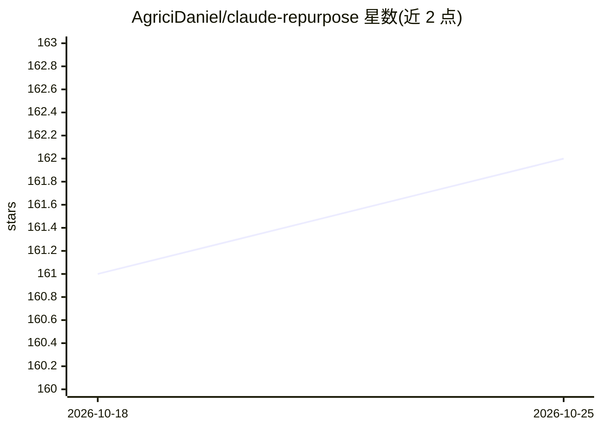

# AgriciDaniel/claude-repurpose

⭐ 162 · Python · MIT · 推送 2026-04-10 · [GitHub](https://github.com/AgriciDaniel/claude-repurpose) · [官网](https://agricidaniel.com/blog/ai-marketing-automation-stack) · 个人维护

**Claude Code 技能：把一份内容改写为 10+ 平台的原生帖子**

面向 Claude Code 的内容再利用技能：读取博客、YouTube 视频、播客、本地文件等内容，通过 /repurpose 命令生成 20 个平台的平台化输出（推文串、LinkedIn PDF 轮播脚本、TikTok 视频脚本、SEO 元数据、7 天发布日历等）。架构上由 20 个子技能、6 个并行子代理、8 个参考文件和 3 个内容提取 Python 脚本组成；内置各平台算法与最佳实践数据。需 Claude Code CLI 与 Python 3.10+，yt-dlp、Whisper、/banana 图像生成为可选。

## 筛选速览

| 维度 | 判定 | 备注 |
|---|---|---|
| AI 角色 | `ai-native` | 本体是模型或模型工具 |
| 许可风险 | `permissive` | MIT |
| 部署形态 | `None` |  |
| 模型依赖 | — | README 未给出锁定关系 |
| 硬件要求 | — | 无带数字的原话,不猜 |
| 安装摩擦 | `low` | 无编译、无系统依赖或容器化 |
| 成熟度 | — | 结构信号不足 |

## 能力要点

- 覆盖 20 个平台（Twitter/LinkedIn/Instagram/TikTok/Reddit/Medium 等）的平台化输出
- 20 个子技能 + 6 个并行子代理 + 3 个内容提取脚本
- 内置各平台算法基准数据（2026）与最佳实践参考
- 可选 /banana 生成引用卡片与轮播封面，未装则保存提示词供手动使用

## 适用场景

- 把一篇博客或一期播客改写成多平台内容矩阵
- 生成带最佳发布时间的 7 天发布日历
- 为各平台批量生成 SEO 标题、描述与标签

## 场景标签

`AI 写作` · 领域:内容生成

## 证据(README 行号)

> L5: **Content Repurposing Engine for Claude Code** -- Turn 1 piece of content into 10+ platform-optimized posts in secon
> L13: Takes **any content** (YouTube video, blog post, podcast, local file) and generates **platform-native** outputs for
> L113: - Claude Code CLI

## 星数曲线

2026-10-18 161 → 2026-10-25 162（+1）

---
*卡片 v1 · prompt 1.4 · 生成 2026-10-22 · 置信度 high · 依据 README sha `e73ffcc030cc` · [字段定义](../../DATASET.md)*
