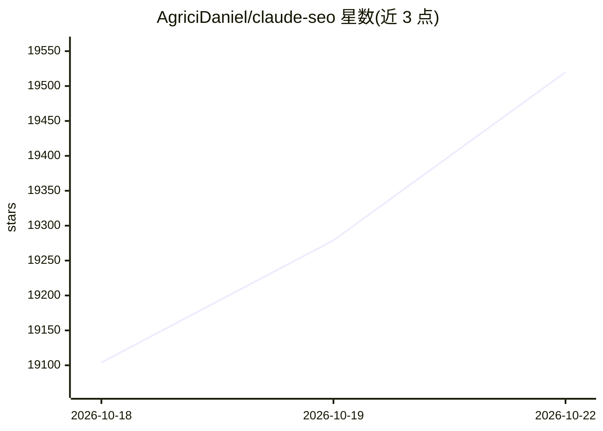

# AgriciDaniel/claude-seo

⭐ 19,520 · Python · MIT · 推送 2026-10-04 · [GitHub](https://github.com/AgriciDaniel/claude-seo) · [官网](skool.com/ai-marketing-hub-pro) · 个人维护

**给 Claude Code 用户的 SEO 审计技能插件**

面向 Claude Code 的开源 SEO 分析插件：26 个子技能与 19 个专项 agent 并行运行，覆盖技术 SEO、E-E-A-T 内容质量、Schema.org 标记、GEO/AI 搜索优化、本地 SEO、电商与国际 SEO，以及 Google API 与 PDF/Excel 报告。审计输出带优先级与可证伪性检查的行动计划。通过 Claude Code 插件市场安装，setup 步骤创建隔离 Python 环境并安装 Playwright Chromium；另提供 9 个可选扩展命令。

## 筛选速览

| 维度 | 判定 | 备注 |
|---|---|---|
| AI 角色 | `ai-native` | 本体是模型或模型工具 |
| 许可风险 | `permissive` | MIT |
| 部署形态 | `None` |  |
| 模型依赖 | — | README 未给出锁定关系 |
| 硬件要求 | — | 无带数字的原话,不猜 |
| 安装摩擦 | `low` | 无编译、无系统依赖或容器化 |
| 成熟度 | — | 结构信号不足 |

## 动量与使用信号

- 维护:`active` — 距上次 push 13.4 天,年发版 29,28 位贡献者
- 涨星:近 1 天 **+84**(自 20261016 起算)
- 下载:GitHub Release 附件 累计 1,937(29 个 release)
- 平台:MACOS / LINUX · 协议:MCP

## 能力要点

- 26 个子技能、19 个专项 agent 并行执行整站审计
- 34 个 /seo 命令，含 /seo agentic（Lighthouse Agentic Browsing、llms.txt、WebMCP）
- 4 层凭证体系从零 key 起步接入 Google SEO API（PageSpeed、CrUX、GSC、GA4、Keyword Planner）
- MIT 开源，另有面向会员的社区私有镜像版本

## 适用场景

- SEO 代理机构对多个客户站点做周期性自动化审计
- SaaS/电商企业内部 SEO 负责人在汇报前做二次核查
- 自由 SEO 顾问用 15 分钟审计向客户展示基线评分

## 场景标签

 · 领域:数字营销/SEO 工具

## 证据(README 行号)

> L5: **Claude SEO is an open-source SEO analysis plugin for Claude Code.** It runs 26 sub-skills and 19 specialist agents
> L103: 34 user-invocable `/seo` commands across the orchestrator, its sub-skills, and 9 MCP extensions. Full reference in

## 星数曲线

2026-10-18 19,104 → 2026-10-22 19,520（+416）

---
*卡片 v1 · prompt 1.4 · 生成 2026-10-18 · 置信度 high · 依据 README sha `4fac21db7744` · [字段定义](../../DATASET.md)*
