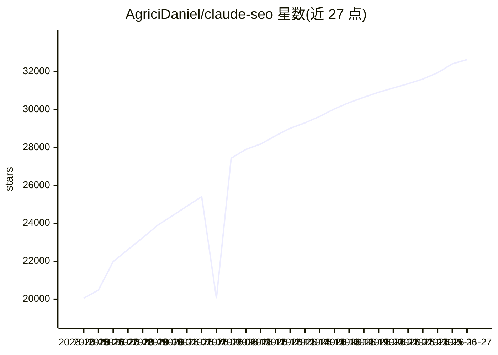

# AgriciDaniel/claude-seo

⭐ 32,627 · Python · MIT · 推送 2026-11-26 · [GitHub](https://github.com/AgriciDaniel/claude-seo) · [官网](skool.com/ai-marketing-hub-pro) · 个人维护

**Claude Code 上的 SEO 审计插件：全面体检并给出行动计划**

以 Claude Code 插件形式提供的 SEO 审计工具，输入网址后 10-15 分钟输出按优先级排序的行动计划。内含 29 个 sub-skill 与 20 个专职 agent，最多 17 个并行工作，检查项覆盖技术 SEO、E-E-A-T、Schema 标记、GEO/AI 搜索可见性、本地与电商 SEO。报告以 Markdown 保存，可经 /seo google report 转 PDF。要求 Claude Code 1.0.33+，运行依赖由 /seo setup 自动准备的隔离 Python 环境与无头浏览器。

## 筛选速览

| 维度 | 判定 | 备注 |
|---|---|---|
| AI 角色 | `ai-native` | 本体是模型或模型工具 |
| 许可风险 | `permissive` | MIT |
| 部署形态 | `None` |  |
| 模型依赖 | — | README 未给出锁定关系 |
| 硬件要求 | — | 无带数字的原话,不猜 |
| 安装摩擦 | `low` | 无编译、无系统依赖或容器化 |
| 成熟度 | — | 结构信号不足 |

## 动量与使用信号

- 维护:`active` — 距上次 push 13.4 天,年发版 29,28 位贡献者
- 涨星:近 1 天 **+84**(自 20261016 起算)
- 下载:GitHub Release 附件 累计 1,937(29 个 release)
- 平台:MACOS / LINUX · 协议:MCP

## 能力要点

- 29 个 sub-skill + 20 个专职 agent，最多 17 个并行审计
- 覆盖 GEO/AEO、Agent Readiness（llms.txt、WebMCP）等 AI 搜索项
- 报告输出 Markdown/PDF/JSON，本地运行、数据不出本机
- 30 条 /seo 命令分六组，含 SQLite 快照的漂移监控

## 适用场景

- 接手新客户网站时快速跑一次全站 SEO 审计
- SEO 团队在季度评审前做补充检查与 AI 搜索可见性分析
- 用 /seo drift 持续监控站点 SEO 变化

## 场景标签

 · 领域:营销/SEO 工具

## 证据(README 行号)

> L26: **Claude SEO is a free SEO plugin for Claude Code.** Give it any website and it runs a full SEO audit in 10 to 15 m
> L36: Claude SEO is built from 29 sub-skills and 20 specialist agents, and up to 17 agents work on your site at the same 
> L143: 2. **The team fans out.** Up to 17 specialist agents audit the site in parallel: technical, content, schema, speed

## 星数曲线

2026-10-25 20,048 → 2026-11-27 32,627（+12,579）

---
*卡片 v1 · prompt 1.4 · 生成 2026-11-27 · 置信度 high · 依据 README sha `32ef943af279` · [字段定义](../../DATASET.md)*
