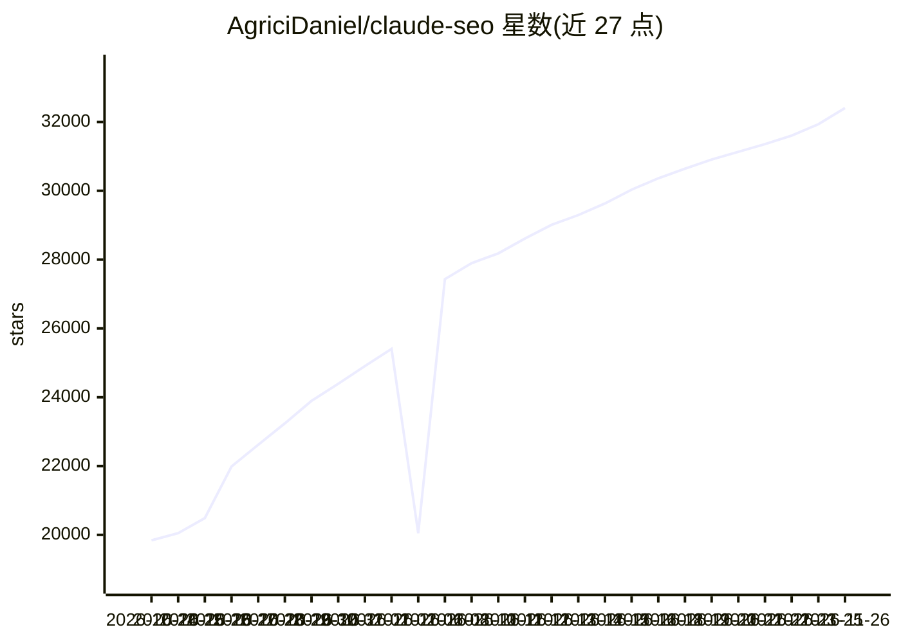

# AgriciDaniel/claude-seo

⭐ 32,404 · Python · MIT · 推送 2026-11-16 · [GitHub](https://github.com/AgriciDaniel/claude-seo) · [官网](skool.com/ai-marketing-hub-pro) · 个人维护

**Claude Code 内的免费 SEO 审计插件，含 GEO/AI 搜索可引用性检查**

运行于 Claude Code 的开源 SEO 插件，由 29 个子技能与 20 个专业 agent 组成，最多 17 个 agent 并行审计单个网站。检查范围覆盖技术 SEO（抓取、索引、Core Web Vitals）、E-E-A-T 内容质量、Schema.org 结构化数据、GEO/AI 搜索可引用性、agent 就绪度（llms.txt、WebMCP）、外链、本地与电商 SEO。输出按优先级排序的行动计划，报告保存为 Markdown，可经 Google API 生成 PDF。需 Claude Code 1.0.33+，另提供 MIT 公共版之外的 Pro 会员私有版本。

## 筛选速览

| 维度 | 判定 | 备注 |
|---|---|---|
| AI 角色 | `ai-native` | 本体是模型或模型工具 |
| 许可风险 | `permissive` | MIT |
| 部署形态 | `None` |  |
| 模型依赖 | — | README 未给出锁定关系 |
| 硬件要求 | — | 无带数字的原话,不猜 |
| 安装摩擦 | `low` | 无编译、无系统依赖或容器化 |
| 成熟度 | — | 结构信号不足 |

## 动量与使用信号

- 维护:`active` — 距上次 push 13.4 天,年发版 29,28 位贡献者
- 涨星:近 1 天 **+84**(自 20261016 起算)
- 下载:GitHub Release 附件 累计 1,937(29 个 release)
- 平台:MACOS / LINUX · 协议:MCP

## 能力要点

- 29 个子技能 + 20 个专业 agent，最多 17 个并行审计
- 覆盖 AI 搜索可引用性（GEO）与 agent 就绪度（llms.txt/WebMCP）
- 30 个 /seo 命令分六组，报告输出 Markdown/PDF/JSON
- 本地运行，数据不出机器

## 适用场景

- SEO 机构为客户做每周例行审计
- SaaS/电商团队在发布前做 SEO 复查
- 自由顾问在首次沟通时现场跑一次审计

## 场景标签

 · 领域:营销/SEO 工具

## 证据(README 行号)

> L26: **Claude SEO is a free SEO plugin for Claude Code.** Give it any website and it runs a full SEO audit in 10 to 15 m
> L36: Claude SEO is built from 29 sub-skills and 20 specialist agents, and up to 17 agents work on your site at the same 

## 星数曲线

2026-10-24 19,842 → 2026-11-26 32,404（+12,562）

---
*卡片 v1 · prompt 1.4 · 生成 2026-11-22 · 置信度 high · 依据 README sha `cf022ce5e4b1` · [字段定义](../../DATASET.md)*
