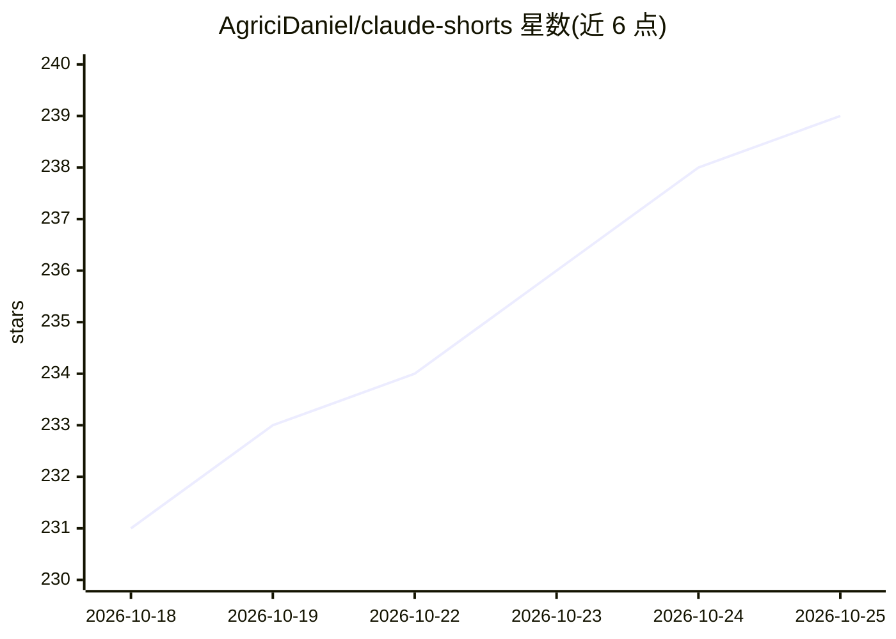

# AgriciDaniel/claude-shorts

⭐ 239 · Python · MIT · 推送 2026-07-11 · [GitHub](https://github.com/AgriciDaniel/claude-shorts) · [官网](https://www.skool.com/ai-marketing-hub-pro/) · 个人维护

**Claude Code 技能：把长视频交互式剪辑为竖屏短视频**

面向内容创作者的 Claude Code 技能（skill），由 Claude 作为编排器引导 10 步交互流程：用 faster-whisper 做带词级时间戳的 GPU 转录，Claude 按五维加权评分从完整转录文本中选出 8-12 个候选片段，切点对齐词边界与静音处，Remotion 渲染 1080x1920 竖屏视频并叠加三种风格的动画字幕，按 YouTube Shorts/TikTok/Instagram Reels 规格导出。依赖 FFmpeg、Python 3.10+、Node.js 18+ 与 Claude Code CLI，Windows 需经 WSL 2 运行。

## 筛选速览

| 维度 | 判定 | 备注 |
|---|---|---|
| AI 角色 | `ai-native` | 本体是模型或模型工具 |
| 许可风险 | `permissive` | MIT |
| 部署形态 | `library` | 以包/库形式分发 |
| 模型依赖 | locked-api |  |
| 硬件要求 | — | 无带数字的原话,不猜 |
| 安装摩擦 | `medium` | 含编译或系统依赖之一 |
| 成熟度 | — | 结构信号不足 |

## 能力要点

- Claude 五维加权评分（钩子强度/连贯性/情绪/价值密度/收尾）筛选候选片段
- Remotion 渲染竖屏视频，三种动画字幕风格与词级卡拉OK高亮
- 切点对齐词边界、句尾与静音点
- 屏幕录制场景用帧差检测光标并跟随裁剪

## 适用场景

- 把演讲或播客长视频剪成 YouTube Shorts/TikTok/Reels 竖屏短片
- 让 Claude 推荐并评分最有传播潜力的片段再人工确认
- 屏幕录制视频自动跟随光标裁剪为竖屏

## 场景标签

`图像视频处理` · 领域:感知与多模态

## 证据(README 行号)

> L5: Interactive longform-to-shortform video creator powered by Claude Code. Extracts viral-ready vertical clips from lon
> L14: 4. **Analyze** - Claude reads the full transcript and scores 8-12 candidate segments
> L76: /shorts

## 星数曲线

2026-10-18 231 → 2026-10-25 239（+8）

---
*卡片 v1 · prompt 1.4 · 生成 2026-10-22 · 置信度 mid · 依据 README sha `0aed0cf368db` · [字段定义](../../DATASET.md)*
