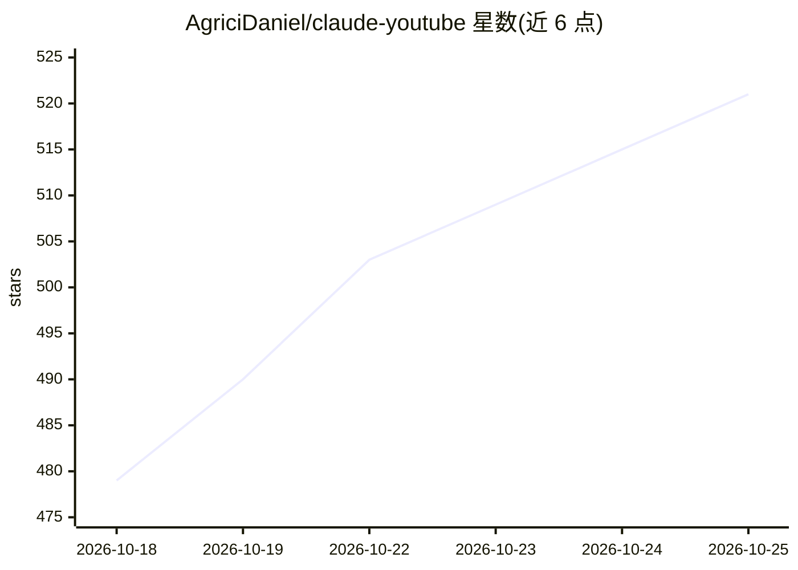

# AgriciDaniel/claude-youtube

⭐ 521 · Python · MIT · 推送 2026-04-10 · [GitHub](https://github.com/AgriciDaniel/claude-youtube) · [官网](https://agricidaniel.com/blog/best-claude-code-skills-2026) · 个人维护

**Claude Code 技能包：把 Claude Code 变成 YouTube 频道增长顾问**

面向 YouTube 创作者的 Claude Code skill：由 SKILL.md 编排器按触发短语路由到 14 个子技能，覆盖频道审计、视频 SEO、留存导向脚本、缩略图简报、内容策略、Shorts 优化、数据分析与变现规划等。安装方式为克隆仓库并复制到 ~/.claude/skills；依赖 Claude Code CLI，Python 3.8+ 仅在运行执行脚本时需要。YouTube API、DataForSEO MCP、NanoBanana MCP 均为可选，缺失时回退手动输入或 WebSearch。当前为 Beta 状态，v1.0 前可能出现破坏性变更。

## 筛选速览

| 维度 | 判定 | 备注 |
|---|---|---|
| AI 角色 | `ai-ecosystem` | LLM/agent 周边工具 |
| 许可风险 | `permissive` | MIT |
| 部署形态 | `None` |  |
| 模型依赖 | locked-api |  |
| 硬件要求 | — | 无带数字的原话,不猜 |
| 安装摩擦 | `low` | 无编译、无系统依赖或容器化 |
| 成熟度 | `idea` | |

## 能力要点

- 14 个子技能命令（audit/seo/script/shorts 等），支持链式多命令工作流
- 三层架构：编排器路由 + 频道类型模板 + 质量门控
- 基准数据带来源标注（CTR/留存/算法机制等 2024-2025 数据）
- 可选接入 YouTube API、DataForSEO MCP 与 NanoBanana MCP（Gemini 生成缩略图）

## 适用场景

- 让 Claude Code 为我的频道做 SEO、留存率健康度审计
- 生成带钩子与节奏设计的视频脚本和上传元数据包
- 规划 30/60/90 天内容日历与多平台分发内容
- 做竞品分析与选题挖掘

## 场景标签

`数据分析` `AI 写作` · 领域:效率与自动化

## 证据(README 行号)

> L5: A comprehensive Claude Code skill for YouTube creators. Covers channel audits, video SEO, retention-engineered scrip
> L55: - Claude Code CLI installed and configured
> L152: |Claude Code|Yes|Core dependency|

## 星数曲线

2026-10-18 479 → 2026-10-25 521（+42）

---
*卡片 v1 · prompt 1.4 · 生成 2026-10-21 · 置信度 high · 依据 README sha `a53fb95008fc` · [字段定义](../../DATASET.md)*
