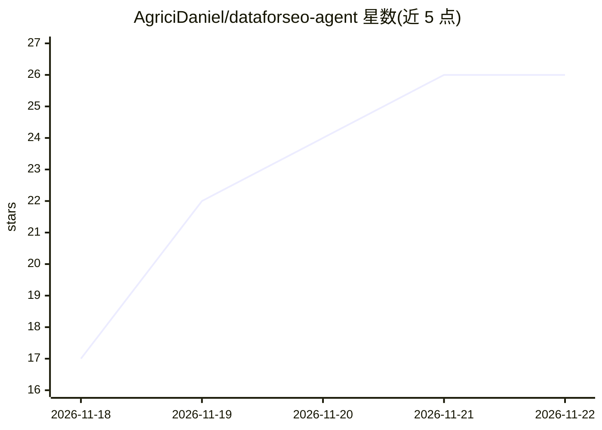

# AgriciDaniel/dataforseo-agent

⭐ 26 · TypeScript · MIT · 推送 2026-11-16 · [GitHub](https://github.com/AgriciDaniel/dataforseo-agent) · [官网](skool.com/ai-marketing-hub-pro) · 个人维护

**终端里的 SEO 问答 agent：自然语言查 DataForSEO 数据并出图表**

面向 SEO 从业者的终端 TUI 应用：用户用自然语言提问，主 agent 将问题路由为 DataForSEO API v3 的 576 个端点调用，由 12 个专科 agent（SERP/关键词/外链/本地等）执行，结果以 16 种终端图表（表格、地理网格、州地图等）或单文件 HTML 报告呈现。核心机制是付费前置：每次付费调用前从目录估价并二次确认，会话预算默认 $1 硬上限。支持 Claude、ChatGPT、Gemini、OpenRouter 等 75+ 模型接入；安装需 Bun、Python 3、Node 22+ 与 DataForSEO 账户。已知限制：shell 工具对 API 地址的检查仅读取命令文本。

## 筛选速览

| 维度 | 判定 | 备注 |
|---|---|---|
| AI 角色 | `ai-native` | 本体是模型或模型工具 |
| 许可风险 | `permissive` | MIT |
| 部署形态 | `None` |  |
| 模型依赖 | locked-api |  |
| 硬件要求 | — | 无带数字的原话,不猜 |
| 安装摩擦 | `low` | 无编译、无系统依赖或容器化 |
| 成熟度 | — | 结构信号不足 |

## 能力要点

- 自然语言路由到 DataForSEO v3 全部 576 个端点，12 个专科 agent 分工
- 付费前估价与双重确认，会话预算默认 $1 由应用强制执行
- 16 种终端图表类型，含本地 SEO 地理网格与美国州地图，可导出 CSV/HTML
- 支持 Claude、ChatGPT、Gemini、OpenRouter 等 75+ 模型接入

## 适用场景

- 用自然语言做关键词研究与竞品排名查询
- 查看本地商户在 Google Maps 各位置的排名网格
- 在预算受控的前提下批量跑 SEO 数据查询并导出报告

## 场景标签

`数据分析` · 领域:效率与自动化

## 证据(README 行号)

> L15: **DataForSEO Agent turns an SEO question into the right DataForSEO API calls, asks before it spends, and shows the 
> L21: - **All of DataForSEO:** 576 active v3 endpoints across 12 APIs, every one live-tested, with a specialist agent per

## 星数曲线

2026-11-18 17 → 2026-11-22 26（+9）

---
*卡片 v1 · prompt 1.4 · 生成 2026-11-18 · 置信度 high · 依据 README sha `e90beb5e5dad` · [字段定义](../../DATASET.md)*
