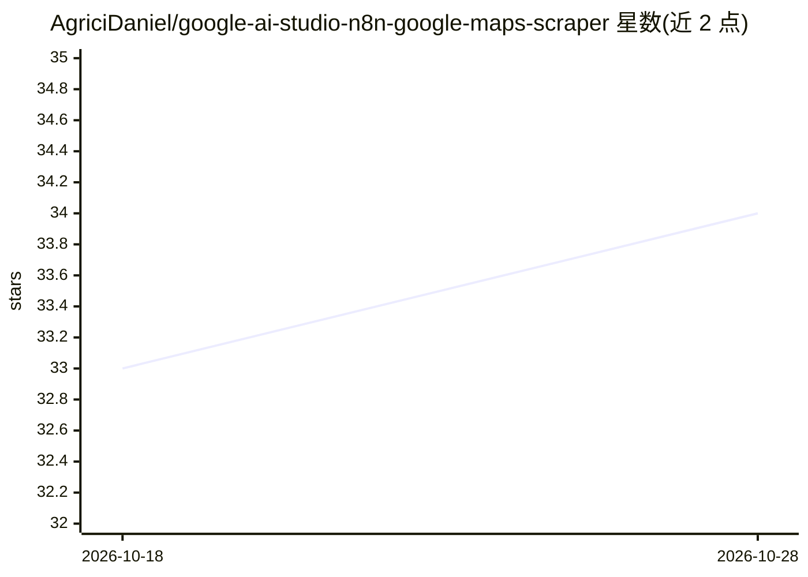

# AgriciDaniel/google-ai-studio-n8n-google-maps-scraper

⭐ 34 · MIT · 推送 2026-04-10 · [GitHub](https://github.com/AgriciDaniel/google-ai-studio-n8n-google-maps-scraper) · [官网](https://agricidaniel.com/blog/n8n-seo-automation-beginners-guide) · 个人维护

**无代码 Google Maps 线索采集教程：AI Studio + n8n 工作流**

配套 YouTube 视频教程的项目仓库，提供一份 n8n 工作流 JSON 和配置指南：用户复制 Google AI Studio 应用模板（基于 Gemini）采集 Google Maps 商户线索，通过 Webhook POST 发送到 n8n 工作流，再写入 Google Sheets。使用需自有 Google 账号、n8n 账号（云端或自托管）及 Gemini API key。本仓库本身不含可运行的应用代码，主要内容是模板链接、工作流 JSON 与图文步骤。

## 筛选速览

| 维度 | 判定 | 备注 |
|---|---|---|
| AI 角色 | `ai-ecosystem` | LLM/agent 周边工具 |
| 许可风险 | `permissive` | MIT |
| 部署形态 | `None` |  |
| 模型依赖 | — | README 未给出锁定关系 |
| 硬件要求 | — | 无带数字的原话,不猜 |
| 安装摩擦 | `low` | 无编译、无系统依赖或容器化 |
| 成熟度 | — | 结构信号不足 |

## 能力要点

- 提供 n8n 工作流 JSON 文件可直接导入
- 数据经 Webhook POST 从 AI Studio 应用流入 n8n 后写入 Google Sheets
- 含 Google AI Studio 应用模板与 Google Sheets 模板链接
- 分 5 步图文配置指南并配套 YouTube 视频教程

## 适用场景

- 按教程搭建自己的 Google Maps 商户线索采集流程
- 学习 Google AI Studio 与 n8n 通过 Webhook 集成的方式
- 将采集结果落地 Google Sheets 或改造为对接 CRM 等其他服务

## 场景标签

`工作流自动化` `教程课程` `网页抓取` · 领域:效率与自动化

## 证据(README 行号)

> L21: 2. Google AI Studio gathers the data and sends it via a `POST` request to a **n8n Webhook**.
> L56: 1. **Download** the `google-ai-studio-scraper.n8n.json` file from this repository.

## 星数曲线

2026-10-18 33 → 2026-10-28 34（+1）

---
*卡片 v1 · prompt 1.4 · 生成 2026-10-25 · 置信度 mid · 依据 README sha `7605534a6bcc` · [字段定义](../../DATASET.md)*
