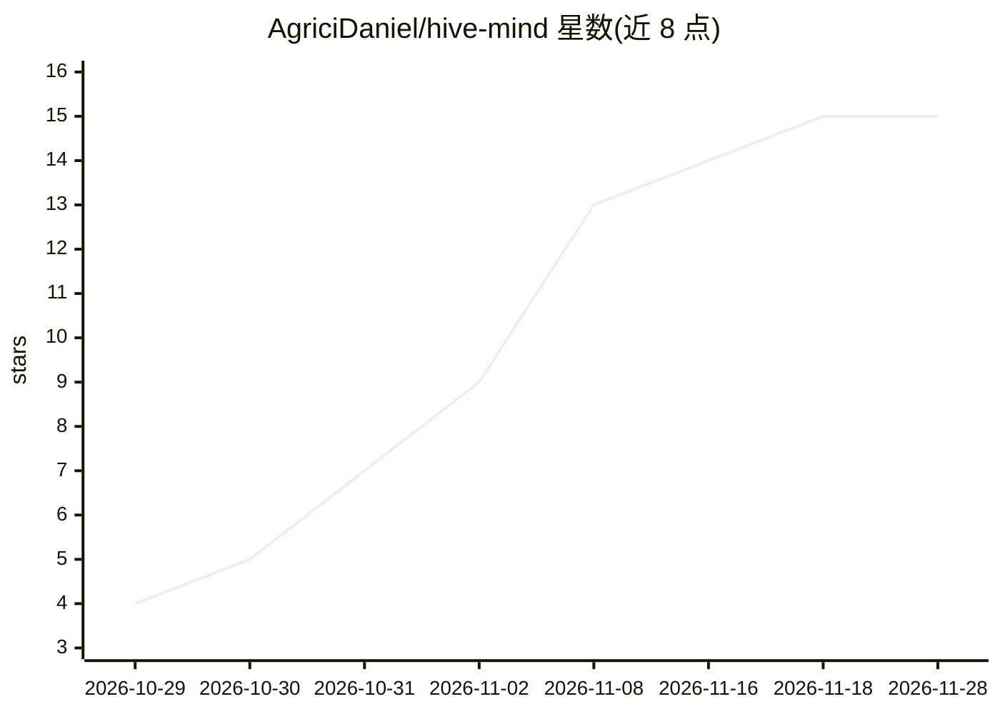

# AgriciDaniel/hive-mind

⭐ 15 · CC-BY-4.0 · 推送 2026-10-27 · [GitHub](https://github.com/AgriciDaniel/hive-mind) · [官网](agricidaniel.com/hive-mind.pdf) · 个人维护

**AI agent 设计指南：九个部件的架构方法，对照 85 份来源**

免费的多智能体架构设计指南，以 Markdown 与 42 页 PDF 形式提供。内容将单个 agent 拆解为身份、共享记忆、技能、工具、方法、限制、循环等九个部件，并给出团队层（hive）与 nervous system（标注为 proposal）的扩展设计。每个部件对照 Anthropic、OpenAI、Google、OWASP、NIST 及同行评审论文等 85 份原始来源核查，逐章附图示、证据比对与可执行清单，并给出从单 agent 到团队的八阶段构建顺序。作者为构建 AI 营销工具的个人开发者。

## 筛选速览

| 维度 | 判定 | 备注 |
|---|---|---|
| AI 角色 | `ai-knowledge` | 知识聚合/清单类 |
| 许可风险 | `viral` | CC-BY-4.0 |
| 部署形态 | `None` |  |
| 模型依赖 | — | README 未给出锁定关系 |
| 硬件要求 | — | 无带数字的原话,不猜 |
| 安装摩擦 | `low` | 无编译、无系统依赖或容器化 |
| 成熟度 | `idea` | |

## 能力要点

- 九部件 agent 架构（身份/共享记忆/技能/工具/方法/限制/循环/hive/nervous system）
- 设计逐项对照 85 份来源（Anthropic/OpenAI/OWASP/NIST/论文），每章附核查清单
- 从单 agent 到八阶段团队的构建顺序与验收标准
- 以 Markdown（每章一文件）与 42 页 PDF 两种形式提供

## 适用场景

- 为已有 agent 按清单逐项检查并修复设计缺陷
- 规划从单 agent 扩展到多 agent 团队的构建顺序
- 查阅带来源链接的 agent 设计证据与实践参考

## 场景标签

`教程课程` · 领域:学习与行业

## 证据(README 行号)

> L30: Then every part was checked against published research and practice: 85 sources, from Anthropic, OpenAI, Google,
> L149: ```text
> L151: the-hive-mind-research-guide.pdf     the full guide, 42 pages

## 星数曲线



2026-10-29 4 → 2026-11-28 15（+11）


---
*卡片 v1 · prompt 1.4 · 生成 2026-11-18 · 置信度 high · 依据 README sha `50bc0a8022d0` · [字段定义](../../DATASET.md)*
