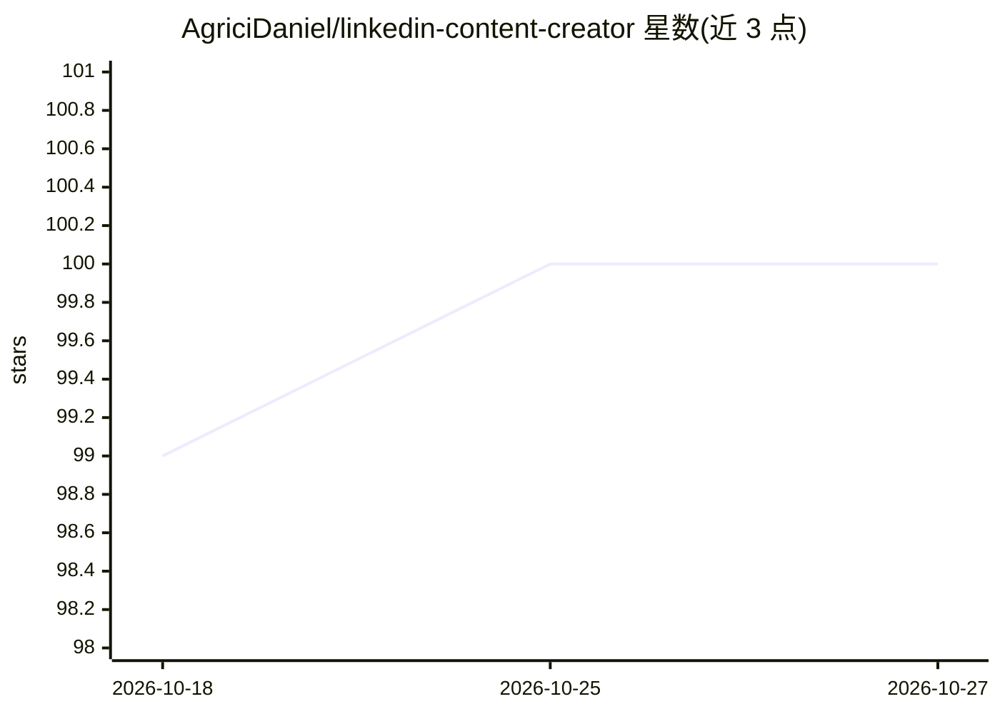

# AgriciDaniel/linkedin-content-creator

⭐ 100 · TypeScript · MIT · 推送 2026-04-10 · [GitHub](https://github.com/AgriciDaniel/linkedin-content-creator) · [官网](https://www.skool.com/ai-marketing-hub-pro) · 个人维护

**面向营销人员的 LinkedIn 帖子 AI 生成与排期工具**

基于 React 18、TypeScript 与 Vite 构建的 Web 应用，调用 Google Gemini API 生成 LinkedIn 文本、图片与轮播帖子；生成前由 AI 先做主题调研，支持批量生成多变体、内容日历排期与品牌口吻配置。内置 Express.js OAuth 代理服务器，可通过 LinkedIn OAuth 直接发帖，Firecrawl API 为可选网页调研依赖。需自备 Gemini API key 与 LinkedIn OAuth 凭据，含 Playwright E2E 测试。

## 筛选速览

| 维度 | 判定 | 备注 |
|---|---|---|
| AI 角色 | `ai-native` | 本体是模型或模型工具 |
| 许可风险 | `permissive` | MIT |
| 部署形态 | `library` | 以包/库形式分发 |
| 模型依赖 | — | README 未给出锁定关系 |
| 硬件要求 | — | 无带数字的原话,不猜 |
| 安装摩擦 | `low` | 无编译、无系统依赖或容器化 |
| 成熟度 | — | 结构信号不足 |

## 能力要点

- Gemini AI 生成文本/图片/轮播三类 LinkedIn 帖子
- 生成前的 AI 主题调研与批量多变体生成
- 内容日历排期与 LinkedIn OAuth 直接发帖
- 品牌口吻、目标受众等配置项

## 适用场景

- 我要批量生成并排期发布 LinkedIn 内容
- 为我的品牌统一内容风格并直接发帖到 LinkedIn
- 让 AI 先调研主题再产出帖子

## 场景标签

`AI 写作` `图像生成` · 领域:内容生成

## 证据(README 行号)

> L3: An AI-powered application for generating and scheduling engaging LinkedIn posts. Built with React, TypeScript, and p
> L9: - **AI Content Generation** - Generate professional LinkedIn posts using Gemini AI
> L22: - **AI**: Google Gemini API

## 星数曲线

2026-10-18 99 → 2026-10-27 100（+1）

---
*卡片 v1 · prompt 1.4 · 生成 2026-10-23 · 置信度 high · 依据 README sha `4c60089b0d66` · [字段定义](../../DATASET.md)*
