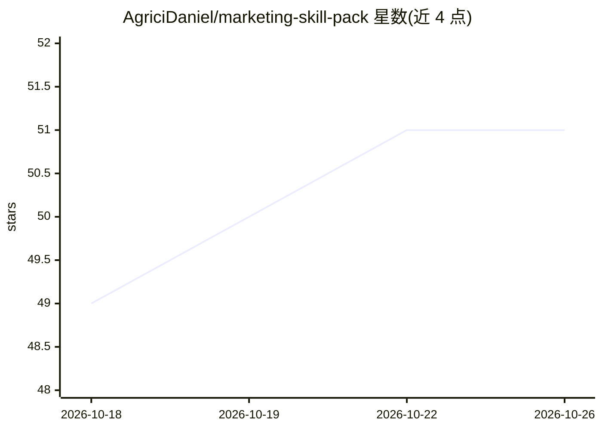

# AgriciDaniel/marketing-skill-pack

⭐ 51 · HTML · MIT · 推送 2026-04-10 · [GitHub](https://github.com/AgriciDaniel/marketing-skill-pack) · [官网](https://agricidaniel.com/blog/ai-marketing-automation-stack) · 个人维护

**一条命令安装 AI 营销技能包（Claude Code 技能集合）**

面向 Claude Code 用户的一键安装脚本：在 macOS/Linux/Windows 下载并运行 install 脚本，将多个技能仓库克隆到 ~/.claude/packs/，安装 Claude SEO、Claude Blog、Skill Forge、WP MCP Ultimate（WordPress 插件）及开发环境配置。重复运行时逐仓库 git pull 更新并重装安装器，支持部分安装续跑，单步失败不中断整体。前置依赖为 git、Node.js 18+、curl、bash（Windows 需 Git Bash 或 WSL）。

## 筛选速览

| 维度 | 判定 | 备注 |
|---|---|---|
| AI 角色 | `ai-ecosystem` | LLM/agent 周边工具 |
| 许可风险 | `permissive` | MIT |
| 部署形态 | `desktop` | 安装包/桌面程序 |
| 模型依赖 | — | README 未给出锁定关系 |
| 硬件要求 | — | 无带数字的原话,不猜 |
| 安装摩擦 | `low` | 无编译、无系统依赖或容器化 |
| 成熟度 | — | 结构信号不足 |

## 能力要点

- macOS/Linux/Windows 三平台一键安装脚本
- 重复运行自动更新各技能仓库并重装
- 支持部分安装续跑，单步错误不中断
- WP MCP Ultimate 插件 ZIP 自动下载到 ~/Downloads

## 适用场景

- 一条命令为 Claude Code 配齐营销相关技能
- 更新已安装的技能包到最新版本
- 通过 /seo、/blog、/skill-forge 斜杠命令使用技能

## 场景标签

 · 领域:开发者工具/AI 技能分发

## 证据(README 行号)

> L5: Install all AI Marketing Hub tools in one command. Works on macOS, Linux, and Windows.
> L65: ## How It Works
> L69: - **Fresh install** → clones all repos and installs skills

## 星数曲线

2026-10-18 49 → 2026-10-26 51（+2）

---
*卡片 v1 · prompt 1.4 · 生成 2026-10-24 · 置信度 high · 依据 README sha `b3827035cf69` · [字段定义](../../DATASET.md)*
