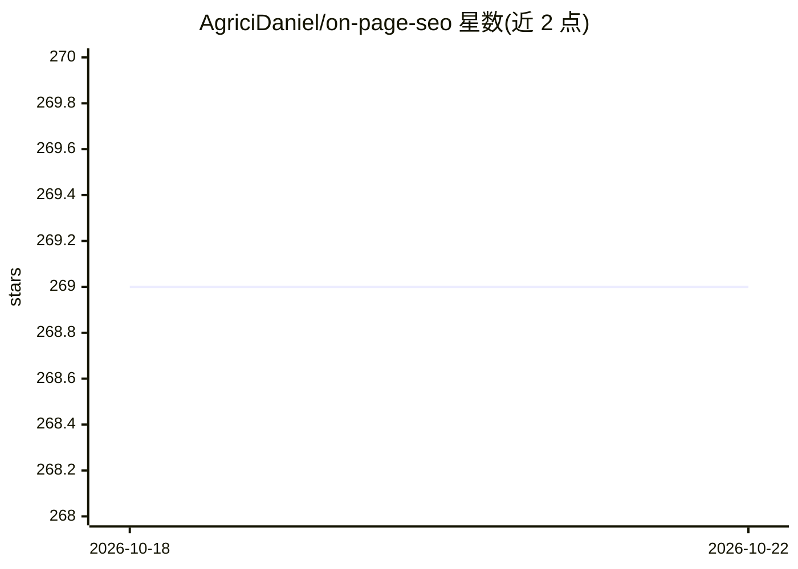

# AgriciDaniel/on-page-seo

⭐ 269 · TypeScript · MIT · 推送 2026-06-06 · [GitHub](https://github.com/AgriciDaniel/on-page-seo) · [官网](https://agricidaniel.com/blog/free-seo-audit-tools) · 个人维护

**网站页面 SEO 审计工具：批量分析最多 500 页的 74 项指标**

自托管的 On-Page SEO 分析应用：通过 Firecrawl API 自动发现网站页面，调用 DataForSEO API 对每页分析 74 项 SEO 指标，并跟踪 LCP/FID/CLS 等 Core Web Vitals，单次审计最多 500 页。前端 React 19 + TypeScript + Vite，后端 Node.js + Express + SQLite，支持实时进度（SSE）、CSV/JSON 导出与暗色模式。需自备 Firecrawl 与 DataForSEO API key，通过 git clone 源码安装运行。

## 筛选速览

| 维度 | 判定 | 备注 |
|---|---|---|
| AI 角色 | `ai-enhanced` | 去掉 AI 部分产品仍成立 |
| 许可风险 | `permissive` | MIT |
| 部署形态 | `None` |  |
| 模型依赖 | — | README 未给出锁定关系 |
| 硬件要求 | — | 无带数字的原话,不猜 |
| 安装摩擦 | `low` | 无编译、无系统依赖或容器化 |
| 成熟度 | — | 结构信号不足 |

## 能力要点

- Firecrawl 页面发现 + DataForSEO 74 项指标分析，单次最多 500 页
- Core Web Vitals（LCP/FID/CLS）跟踪
- SSE 实时审计进度，CSV/JSON 报告导出
- 前后端一体部署，生产模式同端口服务页面与 API

## 适用场景

- 批量审计自己网站的页面 SEO 表现
- 导出 CSV/JSON 报告做 SEO 优化跟踪
- 自托管部署做团队共用的 SEO 检查工具

## 场景标签

 · 领域:SEO/营销工具

## 证据(README 行号)

> L3: A comprehensive on-page SEO analysis tool that helps you audit and optimize your website's SEO performance. Analyze 
> L15: - **Page Discovery**: Automatically discover pages on your website using Firecrawl
> L16: - **Comprehensive Analysis**: Analyze 74 SEO metrics per page using DataForSEO

## 星数曲线

2026-10-18 269 → 2026-10-22 269（+0）

---
*卡片 v1 · prompt 1.4 · 生成 2026-10-22 · 置信度 mid · 依据 README sha `78e3b6dd7d49` · [字段定义](../../DATASET.md)*
