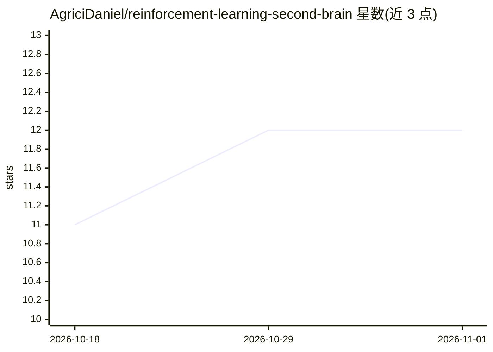

# AgriciDaniel/reinforcement-learning-second-brain

⭐ 12 · Python · NOASSERTION · 推送 2026-09-11 · [GitHub](https://github.com/AgriciDaniel/reinforcement-learning-second-brain) · [官网](https://www.skool.com/ai-marketing-hub-pro) · 个人维护

**强化学习第二大脑：34 个溯源主题的 Obsidian 知识库 + Agent 操作层**

面向 ML 工程师与研究者的强化学习知识库：以 Obsidian vault 形式提供 34 个主题档案（MDPs、Q-learning、PPO、RLHF、DPO、GRPO、agentic RL、world models 等），每条声明追溯到带日期的一手来源，每月刷新，并维护 70 源验证台账。附带 SKILL.md 与 scripts 构成的 agent 操作层，可读取并运行该 vault；提供 ingest/synthesize/report 等 CLI 命令生成报告，并能对训练导出数据标记熵坍塌、KL 尖峰等问题并回引出处。V1 为只读建议性质，不修改任何生产系统。

## 筛选速览

| 维度 | 判定 | 备注 |
|---|---|---|
| AI 角色 | `ai-knowledge` | 知识聚合/清单类 |
| 许可风险 | `none` | NOASSERTION |
| 部署形态 | `library` | 以包/库形式分发 |
| 模型依赖 | — | README 未给出锁定关系 |
| 硬件要求 | — | 无带数字的原话,不猜 |
| 安装摩擦 | `low` | 无编译、无系统依赖或容器化 |
| 成熟度 | — | 结构信号不足 |

## 能力要点

- 34 个主题档案、70 源验证台账，每条声明可追溯到带日期的一手来源
- 每月刷新的研究更新机制与 source-ledger.json 证据记录
- 训练导出适配器：标记熵坍塌、KL 尖峰、reward 崩溃并回引调试规范
- pip 安装后提供 demo/lint/ingest/synthesize/report 等 CLI 命令

## 适用场景

- 查找从经典 RL 到 LLM post-training 的算法选型与调试依据
- 让 AI agent 读取该 vault 生成可溯源的强化学习决策建议
- 对训练 run 导出做问题诊断并获取带引用的分析报告

## 场景标签

`知识库管理` `科研工具` · 领域:知识与检索

## 证据(README 行号)

> L5: A second brain for reinforcement learning that you can actually trust. Every claim traces to a dated primary source,
> L7: It covers the full arc of RL: the classic foundations (MDPs, Q-learning, policy gradients, PPO, SAC), the frontier t
> L13: - `assets/template-brain/` - the distributable Obsidian vault.

## 星数曲线

2026-10-18 11 → 2026-11-01 12（+1）

---
*卡片 v1 · prompt 1.4 · 生成 2026-11-01 · 置信度 high · 依据 README sha `32edfbe7b3d8` · [字段定义](../../DATASET.md)*
