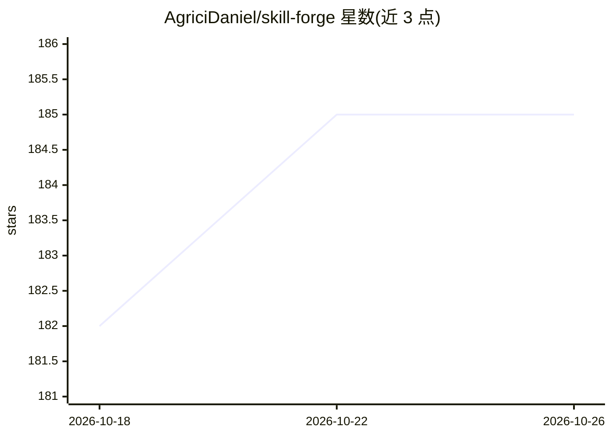

# AgriciDaniel/skill-forge

⭐ 185 · Python · MIT · 推送 2026-04-10 · [GitHub](https://github.com/AgriciDaniel/skill-forge) · [官网](https://agricidaniel.com) · 个人维护

**为开发者设计、构建与发布 Claude Code 技能的技能工程工具**

以 Claude Code 斜杠命令与 Python 脚本形式提供的技能开发工具：支持按用例规划技能架构（4 个复杂度层级）、脚手架生成含 SKILL.md/子技能/脚本的文件树、对既有技能做 0-100 分健康度审计、依据反馈迭代改进、打包为 .skill 文件并生成安装脚本。另支持将技能转换为 OpenAI Codex、Gemini CLI、Antigravity、Cursor 格式，并提供评测与基准管线。依赖 Python 3.10+（仅标准库）与 Claude Code CLI，通过 git clone 加 install.sh 安装。

## 筛选速览

| 维度 | 判定 | 备注 |
|---|---|---|
| AI 角色 | `ai-ecosystem` | LLM/agent 周边工具 |
| 许可风险 | `permissive` | MIT |
| 部署形态 | `None` |  |
| 模型依赖 | — | README 未给出锁定关系 |
| 硬件要求 | — | 无带数字的原话,不猜 |
| 安装摩擦 | `low` | 无编译、无系统依赖或容器化 |
| 成熟度 | — | 结构信号不足 |

## 能力要点

- 规划-构建-审计-演进-发布的技能全流程命令（/skill-forge 系列）
- 0-100 分 6 类质量维度的技能审计
- 技能转换至 Codex/Gemini CLI/Antigravity/Cursor
- 4 级复杂度分层与评测/基准管线

## 适用场景

- 为 Claude Code 创建生产级技能
- 审计并改进已有技能的质量
- 将技能移植到其他 agent 平台

## 场景标签

`代码生成` `模型评测` `提示工程` · 领域:Agent 开发

## 证据(README 行号)

> L7: Design, scaffold, build, review, evolve, and publish production-grade Claude Code skills following the Agent Skills 
> L105: - **Claude Code** — The CLI tool these skills are built for

## 星数曲线

2026-10-18 182 → 2026-10-26 185（+3）

---
*卡片 v1 · prompt 1.4 · 生成 2026-10-22 · 置信度 high · 依据 README sha `85fed80067e9` · [字段定义](../../DATASET.md)*
