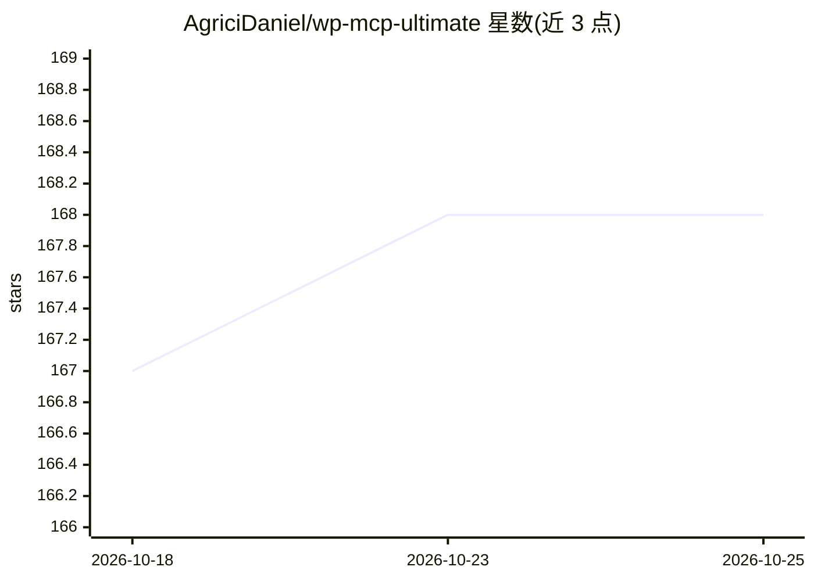

# AgriciDaniel/wp-mcp-ultimate

⭐ 168 · PHP · GPL-2.0 · 推送 2026-08-04 · [GitHub](https://github.com/AgriciDaniel/wp-mcp-ultimate) · [官网](https://agricidaniel.com/blog/wp-mcp-ultimate-wordpress-ai-plugin) · 个人维护

**WordPress 的 MCP 服务器插件：让 AI 客户端直接管理站点内容**

自包含的 WordPress 插件，内置 MCP (Model Context Protocol) 服务器，提供 58 项 WordPress 操作能力，覆盖文章、页面、媒体、用户、插件、菜单、评论与系统管理，供任何 MCP 兼容的 AI 客户端调用。认证支持 Application Password，并内置 OAuth 2.1 授权服务器（PKCE + 动态客户端注册）以适配 Claude Web/Mobile 连接器；默认访问 MCP 端点需要 edit_posts 权限。要求 PHP >= 8.0 与 WordPress >= 6.7，通过上传 zip 或克隆到插件目录安装。

## 筛选速览

| 维度 | 判定 | 备注 |
|---|---|---|
| AI 角色 | `ai-ecosystem` | LLM/agent 周边工具 |
| 许可风险 | `viral` | GPL-2.0 |
| 部署形态 | `None` |  |
| 模型依赖 | locked-api |  |
| 硬件要求 | — | 无带数字的原话,不猜 |
| 安装摩擦 | `low` | 无编译、无系统依赖或容器化 |
| 成熟度 | — | 结构信号不足 |

## 能力要点

- 58 项 WordPress 能力，覆盖内容、媒体、用户、插件、菜单、评论、选项与系统管理
- 兼容 MCP 协议 v2025-06-18，采用 Streamable HTTP 传输
- Application Password 与内置 OAuth 2.1 服务器（PKCE + 动态客户端注册）双认证
- 为 Claude Code、Claude Desktop、Cursor 提供配置导出片段

## 适用场景

- 让 Claude 等 AI 客户端直接读写和管理我的 WordPress 站点
- 通过对话完成发文、媒体上传、插件与用户管理等日常运维
- 在需要 OAuth 的 Claude Web/Mobile 连接器场景接入 WordPress

## 场景标签

 · 领域:Web/CMS 与 AI 集成

## 证据(README 行号)

> L11: Connect WordPress to AI in one click. A self-contained MCP (Model Context Protocol) server plugin with 58 WordPress
> L24: - MCP protocol v2025-06-18 compliance

## 星数曲线

2026-10-18 167 → 2026-10-25 168（+1）

---
*卡片 v1 · prompt 1.4 · 生成 2026-10-22 · 置信度 high · 依据 README sha `f0e0788a9cc2` · [字段定义](../../DATASET.md)*
