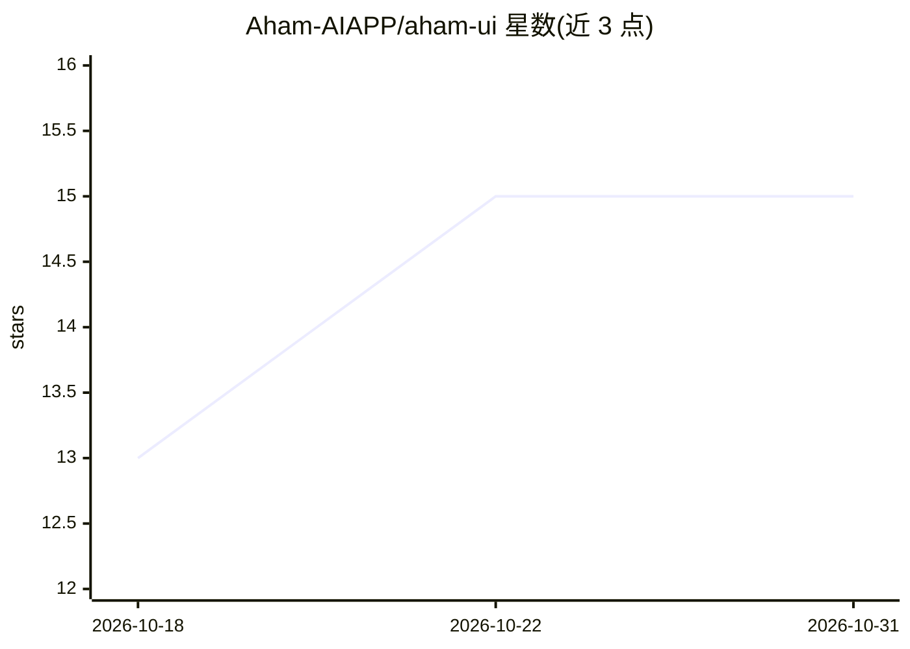

# Aham-AIAPP/aham-ui

⭐ 15 · JavaScript · MIT · 推送 2026-10-30 · [GitHub](https://github.com/Aham-AIAPP/aham-ui) · [官网](https://aham-aiapp.github.io/aham-ui/) · 个人维护 · 中文 README

**供 AI 与人共用的业务管理系统界面规范与样式库**

面向浏览器端业务管理系统（含对外填报页）的界面规范：包含设计理念、取值规则、aham.css/aham.js/tokens.json 与示例页，规定视觉、字号、颜色、密度、单据/列表/键盘交互等约束；AI 和人按同一份文件生成界面，重复生成结果取值与交互一致。可通过 npm 按标签安装并 import CSS，也可直接复制文件；换品牌时改 tokens.json 后运行脚本重新生成 CSS。另附组件交互回归与浏览器测试流程。

## 筛选速览

| 维度 | 判定 | 备注 |
|---|---|---|
| AI 角色 | `ai-enhanced` | 去掉 AI 部分产品仍成立 |
| 许可风险 | `permissive` | MIT |
| 部署形态 | `library` | 以包/库形式分发 |
| 模型依赖 | — | README 未给出锁定关系 |
| 硬件要求 | — | 无带数字的原话,不猜 |
| 安装摩擦 | `low` | 无编译、无系统依赖或容器化 |
| 成熟度 | — | 结构信号不足 |

## 能力要点

- 同一份规范文件供 AI 与人生成一致界面
- 提供 aham.css/aham.js/aham.d.ts 与示例页
- tokens.json 三个值（底色/主色/对比度）重新生成整套中性色
- npm run lab 与 browser.html 提供组件交互回归与错误注入测试

## 适用场景

- 让 AI 按固定规范生成业务管理系统的界面与示例页
- 团队统一后台管理系统与对外填报页的视觉和交互规则
- 通过替换 tokens 取值将规范适配到自有品牌

## 场景标签

 · 领域:前端/设计系统

## 证据(README 行号)

> L8: Aham UI 是一套给电脑浏览器里的业务管理系统用的界面规范，也覆盖这类系统发给外部人员填写的对外填报页，包括设计理念、取值、规则、样式、脚本和示例页。AI 和人按同一份文件生成界面，同一个需求生成几次，取值和交互都一致。
> L52: **交给 AI**：把仓库地址 `https://github.com/Aham-AIAPP/aham-ui` 发给 AI，要求按 AGENTS.md 生成界面。

## 星数曲线

2026-10-18 13 → 2026-10-31 15（+2）

---
*卡片 v1 · prompt 1.4 · 生成 2026-10-31 · 置信度 high · 依据 README sha `f31e4441b68c` · [字段定义](../../DATASET.md)*
