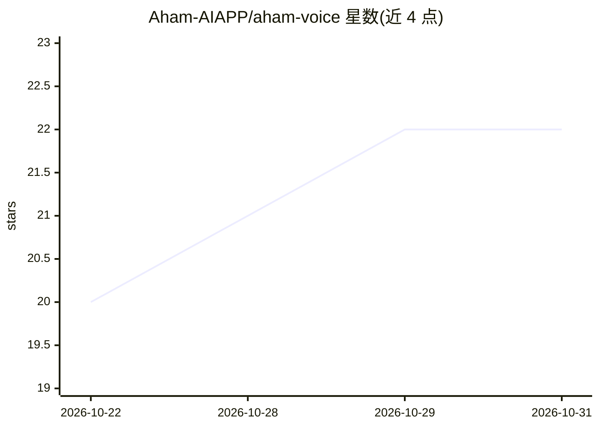

# Aham-AIAPP/aham-voice

⭐ 22 · Python · MIT · 推送 2026-10-27 · [GitHub](https://github.com/Aham-AIAPP/aham-voice) · [官网](https://aham-aiapp.github.io/aham-voice/) · 组织维护 · 中文 README

**销售/项目会议录音转写与纪要系统：本地FunASR+云端DeepSeek**

面向销售与项目会议场景的多用户录音处理系统：本机运行 FunASR 与说话人分离生成带说话人逐字稿，云端调用 DeepSeek 生成会议纪要与对话情绪分析。Web 架构为 Python FastAPI 后端 + React 19 前端（预构建入库，部署无需 Node），支持管理员/经理/成员三级角色、声纹与热词的个人/团队/公司作用域、钉钉同步及 OAuth MCP。推理侧依赖 requirements-asr.txt 锁定的 111 个包与约 3.9G 模型；推理设备默认 CPU，Linux + NVIDIA 可设 cuda:0。旧单机桌面版保留在 archive 分支。

## 筛选速览

| 维度 | 判定 | 备注 |
|---|---|---|
| AI 角色 | `ai-native` | 本体是模型或模型工具 |
| 许可风险 | `permissive` | MIT |
| 部署形态 | `None` |  |
| 模型依赖 | locked-api |  |
| 硬件要求 | — | 无带数字的原话,不猜 |
| 安装摩擦 | `medium` | 含编译或系统依赖之一 |
| 成熟度 | — | 结构信号不足 |

## 能力要点

- 本地 FunASR 转写 + 说话人分离生成逐字稿
- 云端 DeepSeek 生成会议纪要与情绪分析
- 三级用户角色与声纹/热词多级作用域
- 钉钉同步与 OAuth MCP 接入

## 适用场景

- 销售/项目会议录音自动生成带说话人的纪要
- 团队多用户管理录音库并精修纪要
- 通过钉钉同步会议纪要

## 场景标签

`语音识别` · 领域:感知与多模态

## 证据(README 行号)

> L18: 1. 本机跑 FunASR + 说话人分离，把录音转成带说话人的逐字稿；
> L19: 2. 云端调 DeepSeek 生成会议纪要、对话情绪分析。

## 星数曲线

2026-10-22 20 → 2026-10-31 22（+2）

---
*卡片 v1 · prompt 1.4 · 生成 2026-10-28 · 置信度 high · 依据 README sha `379fd9cccbce` · [字段定义](../../DATASET.md)*
