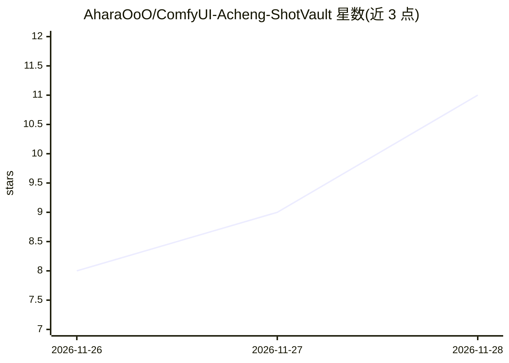

# AharaOoO/ComfyUI-Acheng-ShotVault

⭐ 11 · Python · GPL-3.0 · 推送 2026-11-25 · [GitHub](https://github.com/AharaOoO/ComfyUI-Acheng-ShotVault) · 个人维护 · 中文 README

**ComfyUI 节点套件：MiniMax H3 多镜头视频的分镜规划与拼接**

面向 ComfyUI 的 10 节点套件（8 个核心节点 + 2 个内置接缝节点），围绕 MiniMax H3 模型做多镜头视频生产：交互式分镜规划控制台、逐镜头 9 图 + 3 语音参考条件构建、断点续跑与单镜头双向桥重roll、本地接缝修复与无损合并、带 manifest 校验的母带导出。通过 git clone 到 custom_nodes 安装，示例工作流依赖多个外部社区节点与本地 H3 模型；接缝修复功能标注为实验性。

## 筛选速览

| 维度 | 判定 | 备注 |
|---|---|---|
| AI 角色 | `ai-native` | 本体是模型或模型工具 |
| 许可风险 | `dual` | GPL-3.0 |
| 部署形态 | `desktop` | 安装包/桌面程序 |
| 模型依赖 | — | README 未给出锁定关系 |
| 硬件要求 | — | 无带数字的原话,不猜 |
| 安装摩擦 | `low` | 无编译、无系统依赖或容器化 |
| 成熟度 | — | 结构信号不足 |

## 能力要点

- 10 合 1 节点套件：分镜规划、循环调度、H3 条件构建、接缝修剪、母带组装
- 双向桥单镜头重roll：对齐前后镜头上下文并自动恢复下游 lineage
- 内置 MIT 许可的 ONNX RIFE 接缝修复后端（约 18.5 MB，开箱即用）
- 母带导出原子写入 .manifest.json 快照并标记过期状态，支持 DaVinci FCPXML

## 适用场景

- 用 ComfyUI 生产多镜头短剧/舞蹈 MV 类 AI 视频
- 长脚本分镜后逐镜头生成并断点续跑
- 对单个镜头重roll而不破坏下游镜头连续性
- 导出带 manifest 校验的母带并送入 DaVinci 剪辑

## 场景标签

`视频生成` · 领域:内容生成

## 证据(README 行号)

> L3: **Production-Grade ComfyUI Suite for MiniMax H3 Multi-Shot Planning, Lossless Context Continuation, Bidirectional Br
> L45: |`ShotVaultH3Conditioning`|**ShotVault H3 Conditioning**|Builds per-shot MiniMax H3 multimodal conditioning from ac
> L135: 4. **Generate & Resume**: Click **Run**. Each shot archives immediately upon completion; if interrupted, running a

## 星数曲线

2026-11-26 8 → 2026-11-28 11（+3）

---
*卡片 v1 · prompt 1.4 · 生成 2026-11-26 · 置信度 high · 依据 README sha `759c08f5dc30` · [字段定义](../../DATASET.md)*
