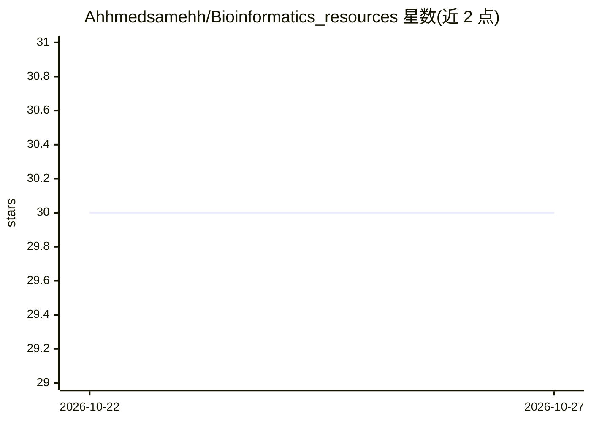

# Ahhmedsamehh/Bioinformatics_resources

⭐ 30 · Python · MIT · 推送 2026-10-24 · [GitHub](https://github.com/Ahhmedsamehh/Bioinformatics_resources) · 个人维护

**面向入门者的生物信息学学习资源策展清单（52 条）**

由个人维护的生物信息学学习指南：以学习路径组织内容，涵盖基础、结构与蛋白质设计、组学与单细胞、工作流可重复性、生物研究 AI 五条路径；每条资源标注先修要求、学习成果、实践活动与解读指引，含格式、难度、语言与获取信息。大部分材料免费，收录阿拉伯语编程材料。仓库附带 Python 脚本（3.9+、免装包）从 catalog.json 生成静态网站，本地可运行预览；作者声明内容基于个人学习经验，非认证或完整课程体系。

## 筛选速览

| 维度 | 判定 | 备注 |
|---|---|---|
| AI 角色 | `ai-knowledge` | 知识聚合/清单类 |
| 许可风险 | `permissive` | MIT |
| 部署形态 | `None` |  |
| 模型依赖 | — | README 未给出锁定关系 |
| 硬件要求 | — | 无带数字的原话,不猜 |
| 安装摩擦 | `low` | 无编译、无系统依赖或容器化 |
| 成熟度 | — | 结构信号不足 |

## 能力要点

- 52 条带注释资源，含先修要求与学习成果标注
- 五条学习路径（基础/结构/组学/工作流/AI）
- Python 3.9+ 免装包脚本生成网站与本地预览
- 收录阿拉伯语编程学习材料

## 适用场景

- 按学习路径入门生物信息学
- 查找结构生物信息学与组学方向的资源
- 通过小项目（RNA-seq、蛋白结构、工作流引擎）练习

## 场景标签

`教程课程` `精选清单` · 领域:学习与行业

## 证据(README 行号)

> L3: A friendly field guide to learning bioinformatics, building reproducible analyses, and exploring modern biological r
> L33: Each topic includes prerequisites, a learning outcome, a practice activity, and interpretation guidance. The **52 a

## 星数曲线

2026-10-22 30 → 2026-10-27 30（+0）

---
*卡片 v1 · prompt 1.4 · 生成 2026-10-26 · 置信度 high · 依据 README sha `b344875f0fdd` · [字段定义](../../DATASET.md)*
