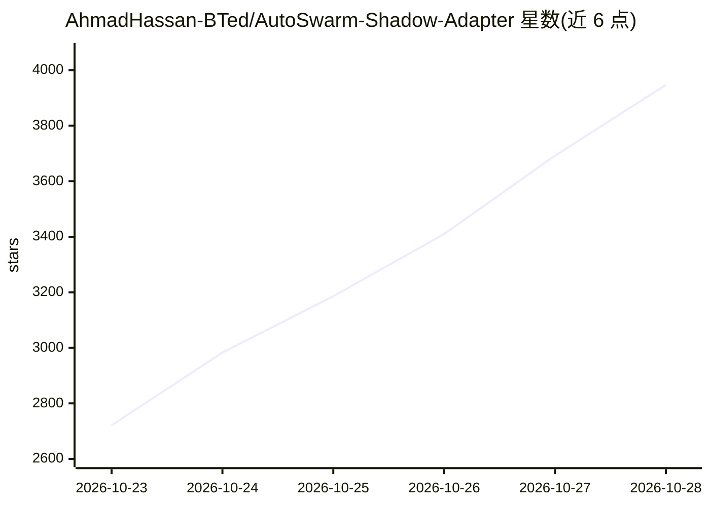

# AhmadHassan-BTed/AutoSwarm-Shadow-Adapter

⭐ 4,208 · Python · MIT · 推送 2026-10-20 · [GitHub](https://github.com/AhmadHassan-BTed/AutoSwarm-Shadow-Adapter) · [官网](https://pypi.org/project/AutoSwarm-shadow-adapter/) · 个人维护

**为 AutoSwarm 提供 HITL 与远程算力接入的非侵入适配器**

面向 AutoSwarm agentic DAG 运行时的 Python 扩展：以零核心修改方式拦截任务执行，在需要人工签核或远程 GPU 执行时将任务存入隔离 SQLite WAL 库并立即返回 AWAITING_HUMAN，避免引擎超时；提供 React 19 审核门户、REST API（shadow-serve）与 shadow-worker 守护进程，支持远程节点用本地 Ollama、Claude API、OpenAI Key 执行任务，交付物归档至 CorporateArtifacts 并写回 AutoSwarm 原生状态机。需 Python 3.10+，经 pip 安装。

## 筛选速览

| 维度 | 判定 | 备注 |
|---|---|---|
| AI 角色 | `ai-ecosystem` | LLM/agent 周边工具 |
| 许可风险 | `permissive` | MIT |
| 部署形态 | `library` | 以包/库形式分发 |
| 模型依赖 | local-ok | 支持本地模型 |
| 硬件要求 | — | 无带数字的原话,不猜 |
| 安装摩擦 | `low` | 无编译、无系统依赖或容器化 |
| 成熟度 | — | 结构信号不足 |

## 能力要点

- 任务拦截耗时 <50ms，非阻塞暂停 DAG 并持久化到 SQLite WAL
- React 19 人工审核门户 + JWT 多用户认证 + 不可变审计时间线
- shadow-worker 支持远程 GPU 节点用本地 Ollama / Claude / OpenAI Key 执行推理（BYOC）
- 交付物注册到 CorporateArtifacts 并按角色层级注入上下文

## 适用场景

- AI agent 工作流中需要人工最终签核的合规场景
- 把远程 PC / GPU 工作站接入 AutoSwarm 作为分布式执行节点
- 一人监督多角色 AI 员工异步交付工作成果

## 场景标签

`多智能体` · 领域:Agent 开发

## 证据(README 行号)

> L21: `AutoSwarm-shadow-adapter` is a high-concurrency **Temporal Bridge** for AutoSwarm. It allows AutoSwarm agentic DAG
> L27: 5. **Symbiotic Architecture**: Functions as an independent, non-invasive extension that plugs into AutoSwarm's exte

## 星数曲线

2026-10-23 2,721 → 2026-10-28 3,947（+1,226）

---
*卡片 v1 · prompt 1.4 · 生成 2026-10-22 · 置信度 high · 依据 README sha `a445f4153eb5` · [字段定义](../../DATASET.md)*
