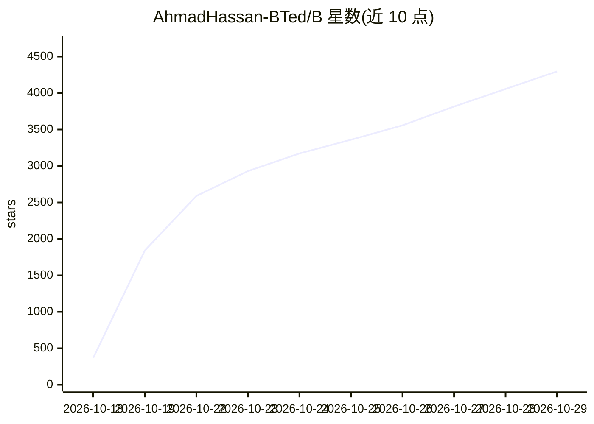

# AhmadHassan-BTed/B

⭐ 4,298 · Python · MIT · 推送 2026-07-07 · [GitHub](https://github.com/AhmadHassan-BTed/B) · 个人维护

**自主感知桌面的 AI 陪伴助手：看屏、听声、说话**

用 Python 编写的桌面 AI 伴侣应用：通过 UIAutomation 和 Tesseract OCR 读取活动窗口内容，Faster-Whisper 做语音转文字，Groq 云 API 或本地 llama-cpp 做推理，Piper ONNX TTS 合成语音，以 PyQt6 绘制 60fps 悬浮表情与聊天气泡。各模块经异步 pub/sub EventBus 解耦。支持主动介入的 Work Mode 与全局热键。面向终端用户，需配置 Groq API key，从源码运行。

## 筛选速览

| 维度 | 判定 | 备注 |
|---|---|---|
| AI 角色 | `ai-native` | 本体是模型或模型工具 |
| 许可风险 | `permissive` | MIT |
| 部署形态 | `library` | 以包/库形式分发 |
| 模型依赖 | locked-api |  |
| 硬件要求 | — | 无带数字的原话,不猜 |
| 安装摩擦 | `low` | 无编译、无系统依赖或容器化 |
| 成熟度 | — | 结构信号不足 |

## 能力要点

- UIA/Tesseract OCR 屏幕语义感知与活动窗口跟踪
- Groq 云端或 llama-cpp 本地 LLM 推理可选
- Faster-Whisper 语音识别 + Piper ONNX TTS 语音合成
- 60fps PyQt6 悬浮表情渲染与物理运动引擎

## 适用场景

- 让 AI 陪伴角色常驻桌面并主动对话
- 工作时开启 Work Mode 获得基于屏幕上下文的建议
- 通过语音或热键与桌面助手交互

## 场景标签

`语音 Agent` `AI 助手` · 领域:对话与助手

## 证据(README 行号)

> L12: **B** is not just an AI : he is a digital lifeform designed to live on your desktop. Built with a soul-first archit
> L75: |**CognitiveEngine**|`brain/llm.py`|LLM inference orchestration (Groq cloud or local llama-cpp). Manages context, h
> L122: |**Neural Hearing**|`Faster-Whisper`|Industry-grade transcription with neural VAD for reliable ears.|

## 星数曲线

2026-10-18 371 → 2026-10-29 4,298（+3,927）

---
*卡片 v1 · prompt 1.4 · 生成 2026-10-21 · 置信度 mid · 依据 README sha `ed5f99024eac` · [字段定义](../../DATASET.md)*
