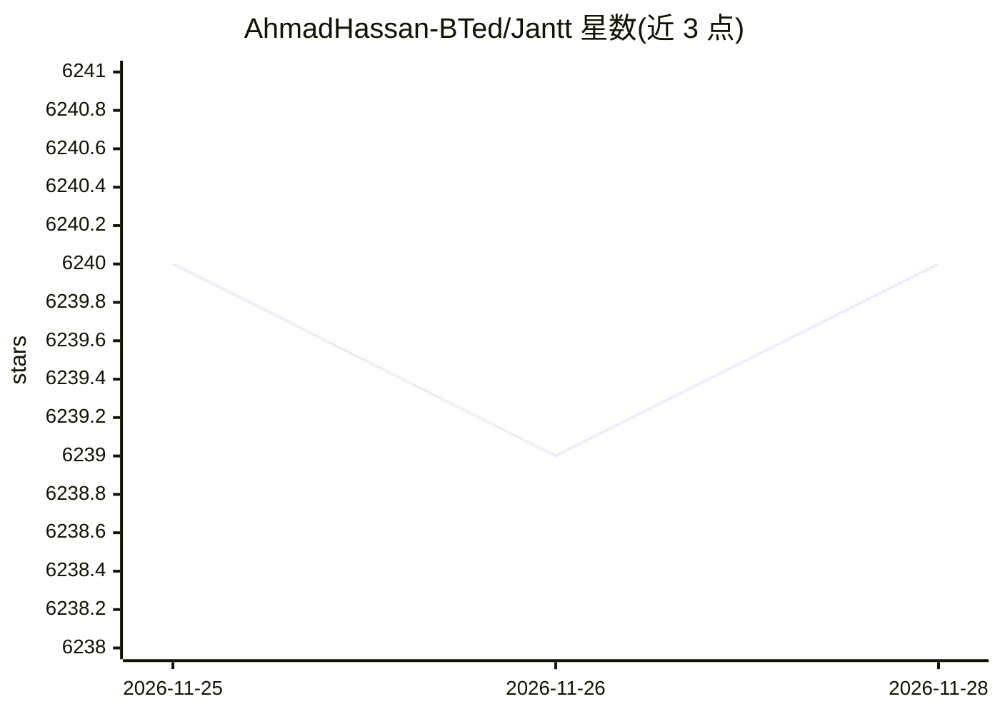

# AhmadHassan-BTed/Jantt

⭐ 6,240 · TypeScript · MIT · 推送 2026-11-27 · [GitHub](https://github.com/AhmadHassan-BTed/Jantt) · [官网](https://ahmadhassan-bted.github.io/Jantt/) · 个人维护

**无代码 AI 甘特图工具，内置多模型 Copilot**

Jantt 是开源（MIT）的甘特图/时间线工具，用户通过拖拽或自然语言描述生成计划，无需编写代码或 JSON。内置 AI Copilot 支持直连 10 个云端模型供应商或本地 Ollama，密钥存于浏览器本地，AI 输出经 JSON Schema 校验并以 diff 预览后应用。核心能力包括工作日历 CPM 关键路径、EVM、蒙特卡洛模拟、6 种同步视图、10 万任务 Canvas 渲染，以及 MS Project XML 与 Primavera P6 XER 导入导出。提供免费云房间协作、React/Vue/Svelte/Python 封装包与 MCP Server。

## 筛选速览

| 维度 | 判定 | 备注 |
|---|---|---|
| AI 角色 | `ai-enhanced` | 去掉 AI 部分产品仍成立 |
| 许可风险 | `permissive` | MIT |
| 部署形态 | `library` | 以包/库形式分发 |
| 模型依赖 | local-ok | 支持本地模型 |
| 硬件要求 | — | 无带数字的原话,不猜 |
| 安装摩擦 | `low` | 无编译、无系统依赖或容器化 |
| 成熟度 | — | 结构信号不足 |

## 能力要点

- 内置 AI Copilot：自然语言生成计划，输出经 Schema 校验并带 diff 预览与撤销
- BYOK 直连 10 个供应商或 100% 离线运行 Ollama
- 工作日历感知的关键路径、EVM、DCMA-14 评级与蒙特卡洛风险模拟
- 官方 MCP Server 提供 6 个确定性调度工具，另有 React/Vue/Svelte/Python 包

## 适用场景

- 用自然语言把会议记录转成带负责人和依赖关系的甘特图
- 管理论文、申请、搬家等个人与学术时间线
- 浏览器内导入导出 MS Project / Primavera P6 排期
- 让 Claude Desktop/Cursor 等 agent 通过 MCP 调用调度工具

## 场景标签

`工作流自动化` · 领域:效率与自动化

## 证据(README 行号)

> L43: |**No Code Needed**|Drag bars visually, resize deadlines, connect arrows, or describe your plan in plain English to
> L57: ### Bring Your Own Key (10 Providers) or Run 100% Free & Local
> L101: - **Official MCP Server (`@jantt/mcp`):** Connect Claude Desktop, Cursor, Gemini, or custom AI agents directly to 

## 星数曲线

2026-11-25 6,240 → 2026-11-28 6,240（+0）

---
*卡片 v1 · prompt 1.4 · 生成 2026-11-28 · 置信度 high · 依据 README sha `af7692c820bb` · [字段定义](../../DATASET.md)*
