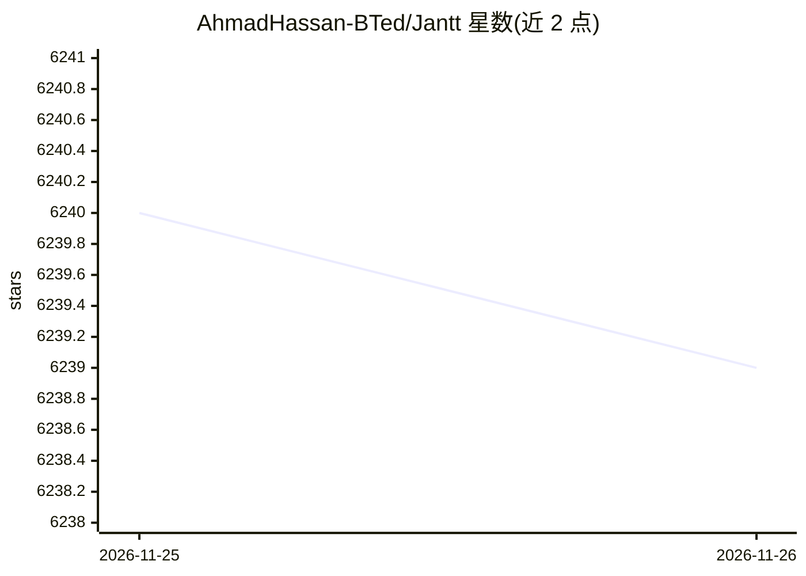

# AhmadHassan-BTed/Jantt

⭐ 6,239 · TypeScript · MIT · 推送 2026-11-24 · [GitHub](https://github.com/AhmadHassan-BTed/Jantt) · [官网](https://ahmadhassan-bted.github.io/Jantt/) · 个人维护

**用自然语言生成甘特图的在线工具与声明式 JSON 时间线引擎**

浏览器端甘特图工具：可视化拖拽编辑、6 种同步视图（时间线/Canvas/看板/清单/仪表盘/笔记）、工作日历驱动的关键路径计算、EVM 与蒙特卡洛分析。内置 AI Copilot，用自然语言描述即生成或修改计划，输出经 JSON Schema 校验并显示增删改 diff 预览后才应用；密钥存于浏览器本地直连提供商，支持 MCP Server 与 React/Vue/Svelte/Python 等嵌入包。MIT 许可，可离线使用。

## 筛选速览

| 维度 | 判定 | 备注 |
|---|---|---|
| AI 角色 | `ai-enhanced` | 去掉 AI 部分产品仍成立 |
| 许可风险 | `permissive` | MIT |
| 部署形态 | `library` | 以包/库形式分发 |
| 模型依赖 | local-ok | 支持本地模型 |
| 硬件要求 | — | 无带数字的原话,不猜 |
| 安装摩擦 | `low` | 无编译、无系统依赖或容器化 |
| 成熟度 | — | 结构信号不足 |

## 能力要点

- 自然语言描述生成/修改计划，AI 输出经 Schema 校验并 diff 预览后才应用
- BYOK 接入 10 个提供商，或经 Ollama 完全本地离线运行
- 工作日历感知的关键路径、DCMA-14、EVM、蒙特卡洛风险模拟
- 官方 MCP Server 暴露 6 个确定性排程工具，支持 React/Vue/Svelte/Python 包

## 适用场景

- 把会议记录粘贴进 Copilot 一键生成带依赖的任务计划
- 管理论文、申请、搬家等个人时间线并导出 PDF 备份
- 在浏览器导入导出 MS Project XML 与 Primavera P6 进度
- 让 AI agent 通过 MCP 直接增删和审计排程任务

## 场景标签

 · 领域:项目管理/计划工具

## 证据(README 行号)

> L3: # Create Interactive Gantt Charts with AI: No Code Required.
> L41: Stop wrestling with spreadsheet rows or begging chatbots for fragile SVG/React code. Jantt ships a **built-in AI Co
> L92: - **Official MCP Server (`@jantt/mcp`):** Connect Claude Desktop, Cursor, Gemini, or custom AI agents directly to 6

## 星数曲线

2026-11-25 6,240 → 2026-11-26 6,239（-1）

---
*卡片 v1 · prompt 1.4 · 生成 2026-11-24 · 置信度 high · 依据 README sha `f7b75243560b` · [字段定义](../../DATASET.md)*
