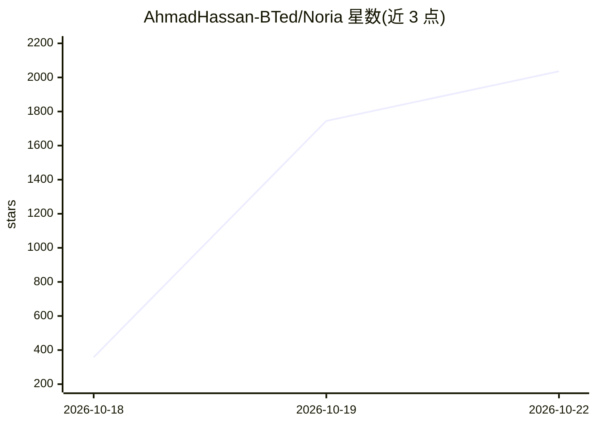

# AhmadHassan-BTed/Noria

⭐ 2,036 · JavaScript · MIT · 推送 2026-07-22 · [GitHub](https://github.com/AhmadHassan-BTed/Noria) · [官网](https://noria-app.streamlit.app/) · 个人维护

**经聊天接收消息/URL、AI 评估机会并回发结构化摘要的 agent**

面向求职者与奖学金申请者的机会抽取系统：通过 WhatsApp 等聊天接收消息与 URL，抓取网页内容，按申请人画像执行 LLM 评估与打分，将结构化摘要与匹配分回发到指定号码。采用六边形架构，scraper/llm/sender 均为可插拔适配器；LLM 支持 Gemini 与 Groq（API key 配置）。提供 npm 启动流水线，并另附 Streamlit Control Center 图形界面（Windows 提供 Noria.exe 独立可执行文件），用于管理申请人档案、扫码连接 WhatsApp、配置扫描并实时监控结果。需 Node.js >=22.12.0。

## 筛选速览

| 维度 | 判定 | 备注 |
|---|---|---|
| AI 角色 | `ai-native` | 本体是模型或模型工具 |
| 许可风险 | `permissive` | MIT |
| 部署形态 | `desktop` | 安装包/桌面程序 |
| 模型依赖 | locked-api |  |
| 硬件要求 | — | 无带数字的原话,不猜 |
| 安装摩擦 | `low` | 无编译、无系统依赖或容器化 |
| 成熟度 | — | 结构信号不足 |

## 能力要点

- 聊天消息/URL → 网页抓取 → LLM 评分 → 结构化摘要回发的完整流水线
- 六边形架构：scraper/llm/sender 适配器经 Registry 启动期校验
- Streamlit Control Center：档案管理、WhatsApp 扫码连接、扫描配置与实时监控
- Windows 提供 Noria.exe 独立可执行文件，首次运行自动装依赖

## 适用场景

- 学生按个人画像自动筛选奖学金机会并经 WhatsApp 接收提醒
- 开发者匹配远程职位信息并获取结构化匹配评分
- 以自定义评分矩阵对聊天中的链接做 AI 评估

## 场景标签

`网页抓取` · 领域:效率与自动化

## 证据(README 行号)

> L9:  A Decoupled, Hexagonal Pipeline Orchestrator for Opportunity Extraction & Generative Evaluation
> L15: Opportunities define careers, yet discovery remains a chaotic manual process. Noria was created to bridge this gap.
> L51:     actor TargetChat as WhatsApp Group/Chat

## 星数曲线

2026-10-18 358 → 2026-10-22 2,036（+1,678）

---
*卡片 v1 · prompt 1.4 · 生成 2026-10-21 · 置信度 high · 依据 README sha `52c929e37347` · [字段定义](../../DATASET.md)*
