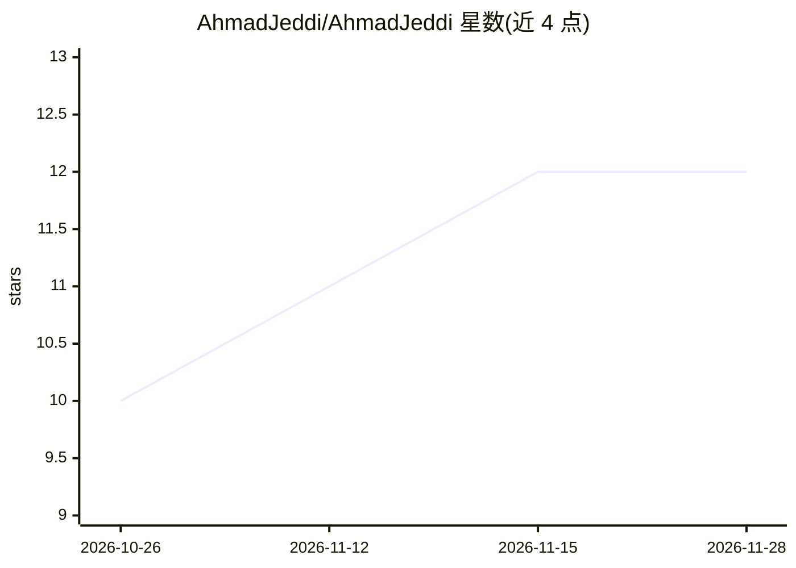

# AhmadJeddi/AhmadJeddi

⭐ 12 · 推送 2026-08-09 · [GitHub](https://github.com/AhmadJeddi/AhmadJeddi) · 个人维护

**AI 研究工程师的个人主页：展示语音/视觉研究与前端项目**

个人 GitHub 主页 README，介绍计算机工程专业毕业生、AI 研究工程师 Ahmad JeddiZahed 的研究方向与项目清单。研究方向包括语音处理、计算机视觉与高效 AI 系统；列出语音情感识别框架、植物病害分类（ResNet50+DCBAM）、ResNet-DCBAM 模块化实现等研究与 AI 项目，以及 SafeIP、JavaScript 学习笔记、落地页等软件项目；并分门别类展示 Python/PyTorch 与前端技术栈。无安装或运行说明。

## 筛选速览

| 维度 | 判定 | 备注 |
|---|---|---|
| AI 角色 | `ai-knowledge` | 知识聚合/清单类 |
| 许可风险 | `none` | — |
| 部署形态 | `None` |  |
| 模型依赖 | — | README 未给出锁定关系 |
| 硬件要求 | — | 无带数字的原话,不猜 |
| 安装摩擦 | `low` | 无编译、无系统依赖或容器化 |
| 成熟度 | — | 结构信号不足 |

## 能力要点

- 列出语音情感识别框架（Log-Mel 与 WavLM 表征对比）
- 植物病害分类项目使用 ResNet50 加 DCBAM 注意力机制
- 分 AI/前端/工具三类展示技术栈
- 附 LinkedIn、ORCID、Email 等联系方式

## 适用场景

- 了解该开发者的研究方向与在研项目
- 查找其语音处理与计算机视觉相关仓库入口
- 通过 GitHub Discussions 与作者交流

## 场景标签

 · 领域:个人主页/项目展示

## 证据(README 行号)

> L24: ## 🔬 Research Interests
> L30: ### 🔬 Research & AI

## 星数曲线

2026-10-26 10 → 2026-11-28 12（+2）

---
*卡片 v1 · prompt 1.4 · 生成 2026-11-18 · 置信度 high · 依据 README sha `25f04dcc1742` · [字段定义](../../DATASET.md)*
