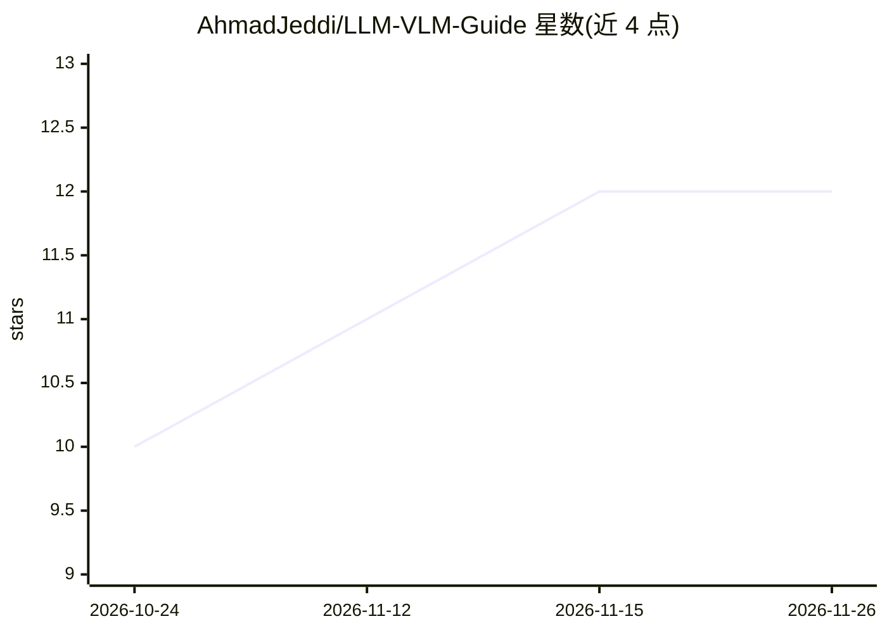

# AhmadJeddi/LLM-VLM-Guide

⭐ 12 · MIT · 推送 2026-09-07 · [GitHub](https://github.com/AhmadJeddi/LLM-VLM-Guide) · 个人维护

**面向初学者的语言与多模态模型原理图文教程**

一份故事线驱动的入门教程文档，从语言模型的下一词预测讲起，依次覆盖 RNN/LSTM 的上下文问题、Transformer 与注意力机制（Q/K/V、自注意力与多头注意力、缩放点积公式）、三种架构形态（encoder-only/decoder-only/encoder-decoder）直至 LLM 的定义。正文与 Technical deep dive 分层组织，配套 MODEL_GUIDE.md 速查表、REFERENCES.md 来源索引与架构图资源。纯阅读材料，无可运行代码。

## 筛选速览

| 维度 | 判定 | 备注 |
|---|---|---|
| AI 角色 | `ai-knowledge` | 知识聚合/清单类 |
| 许可风险 | `permissive` | MIT |
| 部署形态 | `None` |  |
| 模型依赖 | — | README 未给出锁定关系 |
| 硬件要求 | — | 无带数字的原话,不猜 |
| 安装摩擦 | `low` | 无编译、无系统依赖或容器化 |
| 成熟度 | — | 结构信号不足 |

## 能力要点

- 故事线式讲解：从用户提问场景引出表示、注意力与架构演进
- 正文与 'Technical deep dive' 分层，公式与术语不干扰主线
- 以对比表总结 encoder-only/decoder-only/encoder-decoder 三种形态
- 配套速查表、来源索引与架构流程图文件

## 适用场景

- 系统理解 Transformer、注意力与 LLM 等概念之间的联系
- 为 Transformer 架构课程或自学的入门阅读材料
- 在阅读架构图前建立整体心智模型

## 场景标签

`教程课程` · 领域:学习与行业

## 证据(README 行号)

> L3: > A beginner-first, story-driven guide to how modern language and multimodal models work — from the first language-m
> L20: ## How to use this guide
> L28: - `MODEL_GUIDE.md` is the quick reference sheet.

## 星数曲线

2026-10-24 10 → 2026-11-26 12（+2）

---
*卡片 v1 · prompt 1.4 · 生成 2026-11-18 · 置信度 high · 依据 README sha `f2a317f1b618` · [字段定义](../../DATASET.md)*
