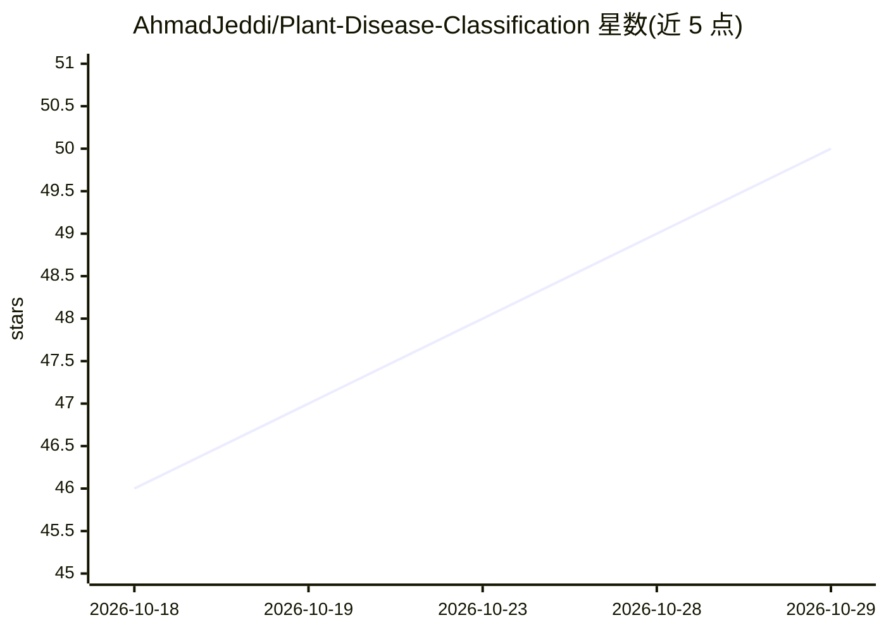

# AhmadJeddi/Plant-Disease-Classification

⭐ 50 · Python · MIT · 推送 2026-10-19 · [GitHub](https://github.com/AhmadJeddi/Plant-Disease-Classification) · 个人维护

**基于 ResNet50-DCBAM 的植物病害图像分类框架**

在 PyTorch 上实现的植物病害分类研究框架：以 ImageNet 预训练 ResNet50 为骨干，加入 DCBAM 通道与空间注意力模块，支持 c2/c3/c4/c5 特征层级选择，经全局平均池化与线性分类器输出病害类别。使用 PlantVillage 官方训练/测试划分，训练集再按固定种子做确定性分层 90/10 切分，测试集仅用于最终评估。提供训练、评估脚本，输出分类报告与混淆矩阵，在 38 类 10,709 张测试图上报告准确率 99.65%。面向希望复现或开展受控对比实验的研究者与开发者。

## 筛选速览

| 维度 | 判定 | 备注 |
|---|---|---|
| AI 角色 | `ai-native` | 本体是模型或模型工具 |
| 许可风险 | `permissive` | MIT |
| 部署形态 | `library` | 以包/库形式分发 |
| 模型依赖 | — | README 未给出锁定关系 |
| 硬件要求 | — | 无带数字的原话,不猜 |
| 安装摩擦 | `low` | 无编译、无系统依赖或容器化 |
| 成熟度 | — | 结构信号不足 |

## 能力要点

- ResNet50 骨干 + DCBAM 通道/空间注意力，特征层级可选（c2-c5）
- PlantVillage 官方划分 + 确定性分层 90/10 验证切分，测试集独立
- 生成分类报告、归一化混淆矩阵与训练曲线
- 双检查点（最优验证损失/最优验证精度）按同一测试协议评估

## 适用场景

- 复现或扩展 ResNet50-DCBAM 的植物病害分类实验
- 在 PlantVillage 数据集上做受控的注意力机制对比研究
- 获取带完整指标与可视化输出的可复现训练评估流程

## 场景标签

`目标检测` · 领域:感知与多模态

## 证据(README 行号)

> L12: This repository provides a reproducible implementation of a deep
> L16: **ResNet50 backbone enhanced with DCBAM (Dual Channel & Spatial
> L165:  Disease Class Prediction

## 星数曲线

2026-10-18 46 → 2026-10-29 50（+4）

---
*卡片 v1 · prompt 1.4 · 生成 2026-10-25 · 置信度 mid · 依据 README sha `b2815b45fb3c` · [字段定义](../../DATASET.md)*
