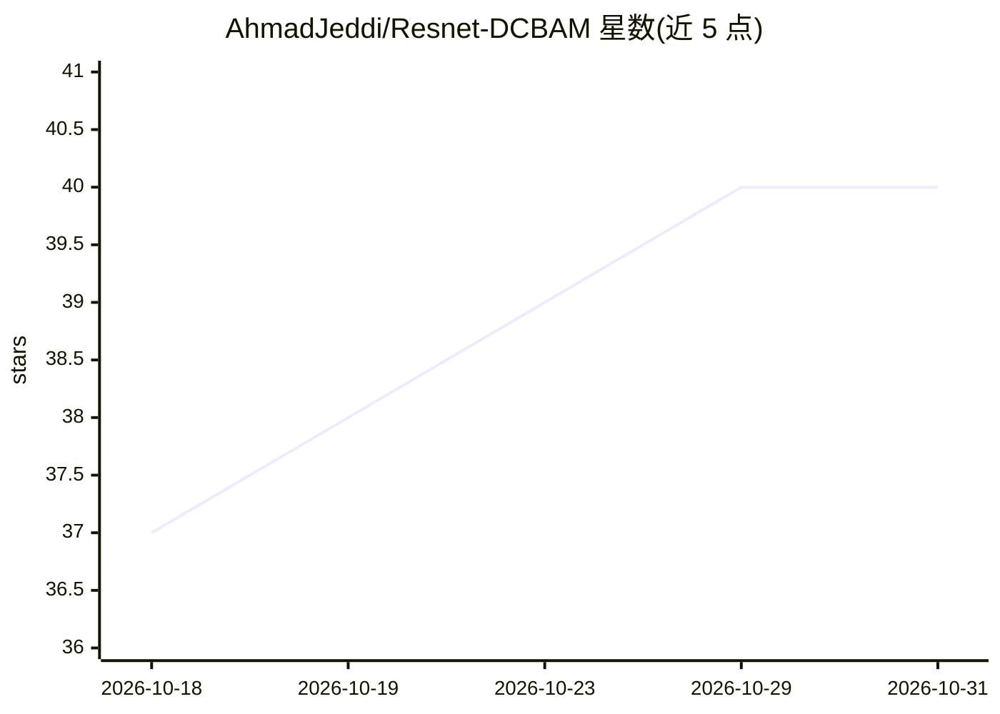

# AhmadJeddi/Resnet-DCBAM

⭐ 40 · Python · MIT · 推送 2026-07-26 · [GitHub](https://github.com/AhmadJeddi/Resnet-DCBAM) · 个人维护

**PyTorch 实现的 DCBAM 注意力模块与 ResNet50 骨干网络**

提供 DCBAM（双通道+空间注意力）模块的 PyTorch 模块化实现，并封装一个 ResNet50 风格骨干网络，支持可选集成 DCBAM、加载预训练权重与冻结层。模块 `models.attention.dcbam` 独立可复用，附带类型注解、文档字符串、示例脚本 `examples/test_backbone.py` 与打包文件。面向需要注意力机制骨干网络的研究与开发用途，MIT 许可。安装方式为 venv 加 pip 安装 requirements.txt。

## 筛选速览

| 维度 | 判定 | 备注 |
|---|---|---|
| AI 角色 | `ai-native` | 本体是模型或模型工具 |
| 许可风险 | `permissive` | MIT |
| 部署形态 | `library` | 以包/库形式分发 |
| 模型依赖 | — | README 未给出锁定关系 |
| 硬件要求 | — | 无带数字的原话,不猜 |
| 安装摩擦 | `low` | 无编译、无系统依赖或容器化 |
| 成熟度 | — | 结构信号不足 |

## 能力要点

- DCBAM（双通道+空间注意力）模块的独立可复用实现
- ResNet50 风格骨干网络支持可选集成 DCBAM 与预训练权重加载
- 提供示例脚本验证输出形状与用法

## 适用场景

- 在视觉模型中引入 DCBAM 注意力机制构建骨干网络
- 复用独立注意力模块进行消融或对比实验
- 基于示例脚本快速验证模型前向传播与形状

## 场景标签

 · 领域:计算机视觉/深度学习

## 证据(README 行号)

> L3: A clean, GitHub-ready PyTorch implementation of **DCBAM (Dual Channel + Spatial Attention)** and a ResNet50 backbone
> L25: * **Backbone**: `models.backbone.resnet_dcbam` encapsulates the ResNet50-like backbone and uses pretrained weights 

## 星数曲线

2026-10-18 37 → 2026-10-31 40（+3）

---
*卡片 v1 · prompt 1.4 · 生成 2026-10-25 · 置信度 mid · 依据 README sha `02ef4bff9874` · [字段定义](../../DATASET.md)*
