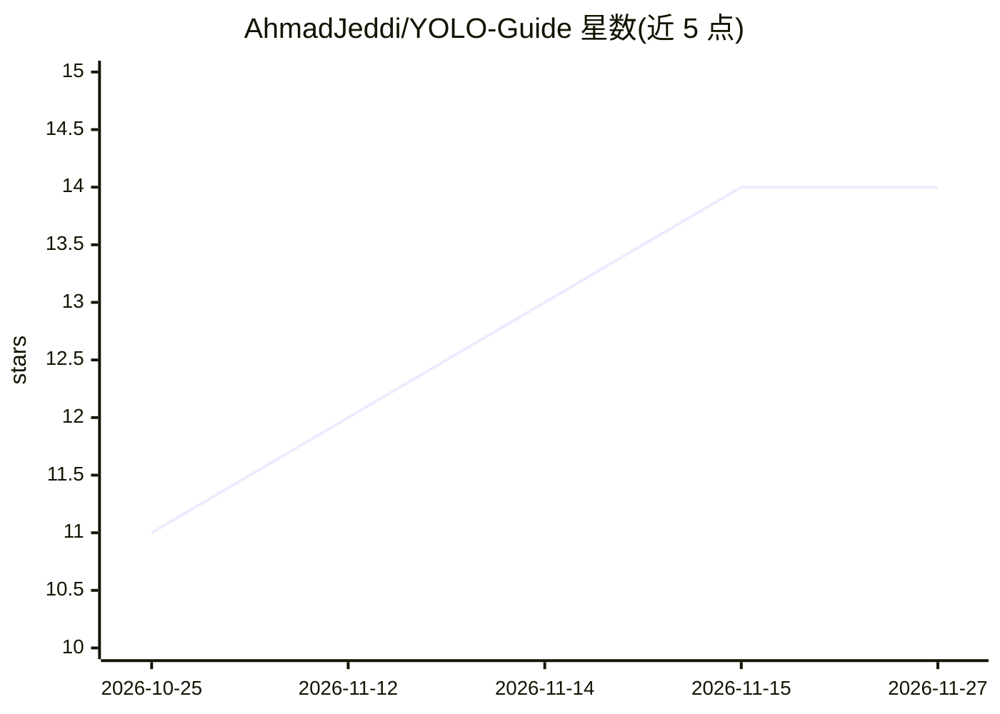

# AhmadJeddi/YOLO-Guide

⭐ 14 · MIT · 推送 2026-08-23 · [GitHub](https://github.com/AhmadJeddi/YOLO-Guide) · 个人维护

**面向初学者的 YOLO 生态架构与版本演进技术指南**

以文档形式组织的 YOLO 家族参考资料，内容覆盖单阶段检测原理、Backbone/Neck/Head 架构、IoU/AP/mAP/FLOPs 等指标定义，以及 YOLOv1 至 YOLO26、YOLOX、PP-YOLOE 等官方与独立分支的逐版本介绍和论文报告的基准数据。每节附原始论文引用，并说明 benchmark 来自不同论文与实现、不构成单一可比排行榜。仓库含架构对照矩阵与演进时间线，不含可运行的模型代码或安装流程。

## 筛选速览

| 维度 | 判定 | 备注 |
|---|---|---|
| AI 角色 | `ai-knowledge` | 知识聚合/清单类 |
| 许可风险 | `permissive` | MIT |
| 部署形态 | `None` |  |
| 模型依赖 | — | README 未给出锁定关系 |
| 硬件要求 | — | 无带数字的原话,不猜 |
| 安装摩擦 | `low` | 无编译、无系统依赖或容器化 |
| 成熟度 | — | 结构信号不足 |

## 能力要点

- 逐版本讲解 YOLOv1→YOLO26 及 YOLOX、PP-YOLOE 等独立分支
- 涵盖 anchor-based→anchor-free→NMS-free→开放词汇检测的演进脉络
- 汇总各论文报告的 mAP/FLOPs/延迟基准并注明不可直接横向比较
- 附架构对照矩阵与论文引用列表

## 适用场景

- 系统学习目标检测与 YOLO 架构的基础概念
- 查找各 YOLO 版本的原始论文与官方文档入口
- 对比不同 YOLO 分支的设计取舍与许可注意事项

## 场景标签

`教程课程` `目标检测` · 领域:学习与行业

## 证据(README 行号)

> L5: A research-backed, beginner-friendly reference to the **YOLO ecosystem**, covering its architecture, major versions,
> L23: - Advantages, limitations, and licensing considerations
> L24: - Primary research papers and official documentation

## 星数曲线

2026-10-25 11 → 2026-11-27 14（+3）

---
*卡片 v1 · prompt 1.4 · 生成 2026-11-18 · 置信度 high · 依据 README sha `ed20237ccd8e` · [字段定义](../../DATASET.md)*
