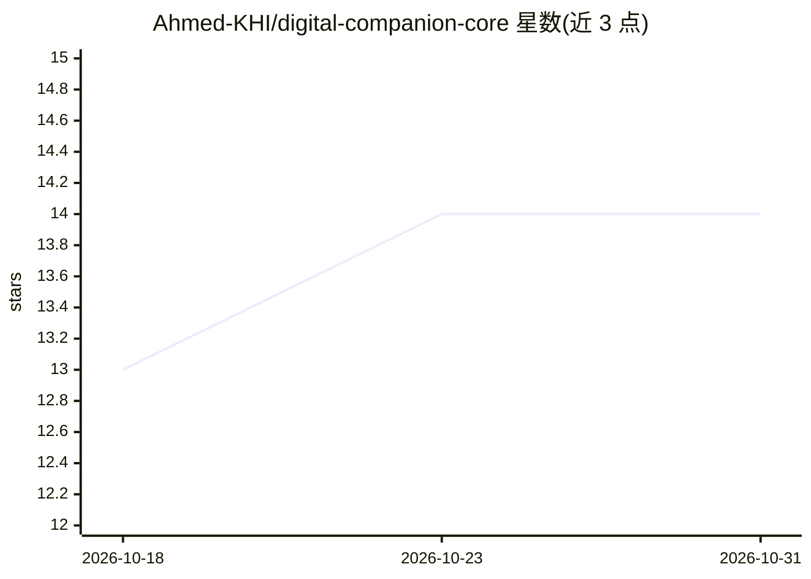

# Ahmed-KHI/digital-companion-core

⭐ 14 · TypeScript · NOASSERTION · 推送 2026-09-25 · [GitHub](https://github.com/Ahmed-KHI/digital-companion-core) · 个人维护

**面向开发者的 AI 人格框架：持久记忆+情绪+性格模型**

TypeScript/npm 库，为 AI persona 提供有状态的性格（Big Five + MBTI）、记忆（短时/长时/情绪/语义）与情绪引擎（动态心情、能量、压力、信心）。Soul 对象可 export/import 为 JSON 快照实现持久化，记忆自动关联与整合，性格随交互演化，支持时间模拟与自我反思（reflect）。提供 createCompanion/createNPC/createTeacher 等工厂函数与 EmpathyAPI。面向游戏 NPC、教育、客服、陪伴等场景的开发者；README 未说明响应生成是否依赖外部 LLM。

## 筛选速览

| 维度 | 判定 | 备注 |
|---|---|---|
| AI 角色 | `ai-ecosystem` | LLM/agent 周边工具 |
| 许可风险 | `none` | NOASSERTION |
| 部署形态 | `library` | 以包/库形式分发 |
| 模型依赖 | — | README 未给出锁定关系 |
| 硬件要求 | — | 无带数字的原话,不猜 |
| 安装摩擦 | `low` | 无编译、无系统依赖或容器化 |
| 成熟度 | — | 结构信号不足 |

## 能力要点

- 四类记忆系统与自动记忆关联整合
- SoulSnapshot JSON 持久化（export/import 校验）
- Big Five + MBTI 性格模型，性格随经历自适应
- 情绪引擎含动态心情、能量、压力、时间模拟与反思

## 适用场景

- 为游戏构建记住玩家选择并演化的 NPC
- 创建有长期记忆与情感状态的陪伴/教育 persona
- 在对话产品中维护持久且可迁移的人格状态

## 场景标签

`Agent 记忆` · 领域:Agent 开发

## 证据(README 行号)

> L9: **What it does in 1 sentence**: Stateful personality + memory + emotion model for AI personas.
> L13: Create digital companions that remember conversations, develop relationships, and evolve their personality over tim

## 星数曲线

2026-10-18 13 → 2026-10-31 14（+1）

---
*卡片 v1 · prompt 1.4 · 生成 2026-10-31 · 置信度 mid · 依据 README sha `e696c4d07969` · [字段定义](../../DATASET.md)*
