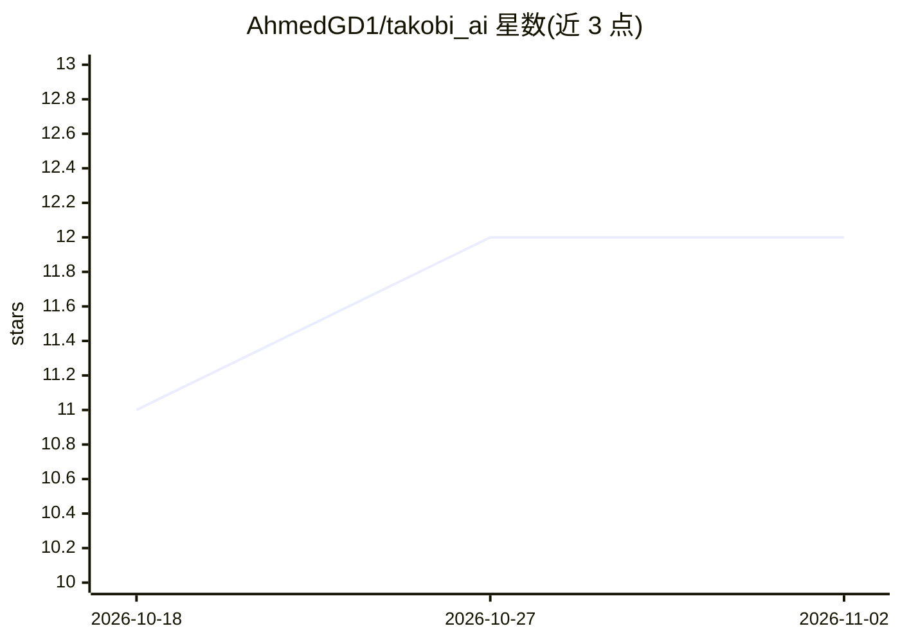

# AhmedGD1/takobi_ai

⭐ 12 · C# · MIT · 推送 2026-10-22 · [GitHub](https://github.com/AhmedGD1/takobi_ai) · 个人维护

**Godot 4/C# 的行为树与层级状态机框架**

面向 Godot 4 C# 项目的游戏 AI 逻辑库：提供反应式与随机化组合节点、Cooldown/Retry/Timeout 等装饰器、$key 前缀的 Blackboard 绑定、SubTree 嵌套复用，以及可独立使用的代码优先层级状态机 TakobiHSM。工程化功能包括基于 EditorDebuggerPlugin 的实时可视化调试面板、Monitors 原生性能计数、专用 Inspector 下拉编辑器与零分配 tick 路径。安装方式为下载 Release 后解包 addons 目录并在 Godot 项目设置中启用插件，MIT 许可。注意：框架本身不涉及机器学习模型，行为树与状态机为经典游戏 AI 技术。

## 筛选速览

| 维度 | 判定 | 备注 |
|---|---|---|
| AI 角色 | `ai-ecosystem` | LLM/agent 周边工具 |
| 许可风险 | `permissive` | MIT |
| 部署形态 | `None` |  |
| 模型依赖 | — | README 未给出锁定关系 |
| 硬件要求 | — | 无带数字的原话,不猜 |
| 安装摩擦 | `low` | 无编译、无系统依赖或容器化 |
| 成熟度 | — | 结构信号不足 |

## 能力要点

- 反应式/加权组合节点与完整装饰器集（Cooldown、Retry、Timeout 等）
- $key 前缀将任意节点导出字段绑定到 Blackboard 值
- 可独立使用的代码优先层级状态机 TakobiHSM，支持嵌套子机
- 编辑器内实时调试面板与 Godot Monitors 原生 tick 计时，零分配 tick 路径

## 适用场景

- 在 Godot 4 C# 游戏中为 NPC/敌人搭建行为树决策逻辑
- 用层级状态机组织角色的复杂状态流转
- 游戏运行时实时调试与观察行为树节点状态

## 场景标签

 · 领域:游戏开发/游戏 AI 框架

## 证据(README 行号)

> L3: A behavior tree library for **Godot 4 / C#**, built on native Godot editor APIs
> L19: - **Rich node library** — reactive and randomized composites (`ReactiveSequence`, `ReactiveSelector`, `Parallel`, `

## 星数曲线

2026-10-18 11 → 2026-11-02 12（+1）

---
*卡片 v1 · prompt 1.4 · 生成 2026-11-01 · 置信度 low · 依据 README sha `96178c412eb3` · [字段定义](../../DATASET.md)*
