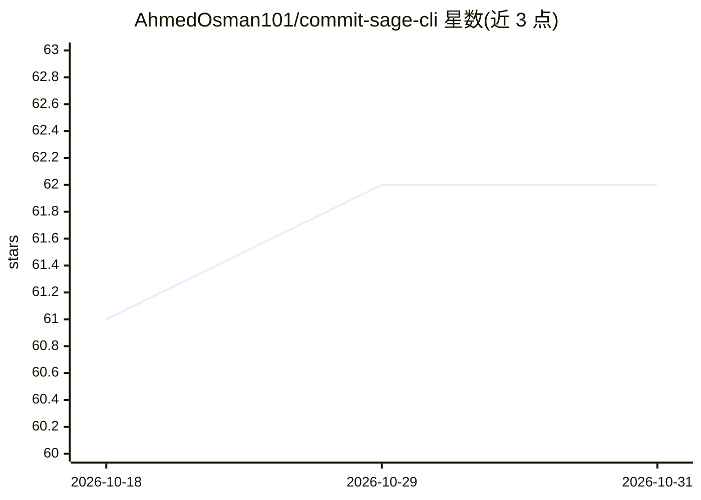

# AhmedOsman101/commit-sage-cli

⭐ 62 · TypeScript · GPL-3.0 · 推送 2026-10-26 · [GitHub](https://github.com/AhmedOsman101/commit-sage-cli) · 个人维护

**用 AI 从 git diff 生成提交信息的跨平台 CLI**

将暂存区的 git diff 发送给 LLM 提供商（OpenAI、Gemini、Ollama 等 11 个），生成 conventional/angular/emoji 等 11 种格式的提交信息；也可用 --offline 走静态分析路径，基于 git diff-index 生成确定性 conventional 信息，无需 API 与网络。提供 generate（输出到 stdout 可管道化）、commit（交互式暂存→预览→提交→可选推送）、config（7 个配置子命令）三个子命令。预编译二进制覆盖 Linux/macOS/Windows 的 x64 与 arm64，另有 macOS DMG、Windows NSIS 安装器、AUR 包与 curl 安装脚本；从源码编译需 Bun 1.4.x 与 mask。

## 筛选速览

| 维度 | 判定 | 备注 |
|---|---|---|
| AI 角色 | `ai-native` | 本体是模型或模型工具 |
| 许可风险 | `viral` | GPL-3.0 |
| 部署形态 | `desktop` | 安装包/桌面程序 |
| 模型依赖 | local-ok | 支持本地模型 |
| 硬件要求 | — | 无带数字的原话,不猜 |
| 安装摩擦 | `medium` | 含编译或系统依赖之一 |
| 成熟度 | — | 结构信号不足 |

## 能力要点

- 11 个 AI 提供商 + --offline 静态分析双路径
- 11 种提交信息格式与 BCP-47 语言指定
- generate 输出可管道化，适配 CI/非 TTY 场景
- 6 平台预编译二进制 + DMG/NSIS/AUR 安装途径

## 适用场景

- 让 AI 根据暂存 diff 起草符合规范的提交信息
- CI 等无 key 环境用 --offline 生成确定性提交信息
- 交互式完成暂存、预览、提交与推送的完整流程

## 场景标签

`AI 写作` · 领域:内容生成

## 证据(README 行号)

> L15: Commit Sage turns your `git diff` into a commit message. Two paths, one surface:
> L17: - **AI path** — diff + context -> provider (OpenAI, Gemini, Ollama, … 11

## 星数曲线

2026-10-18 61 → 2026-10-31 62（+1）

---
*卡片 v1 · prompt 1.4 · 生成 2026-10-24 · 置信度 high · 依据 README sha `196c20a04aa1` · [字段定义](../../DATASET.md)*
