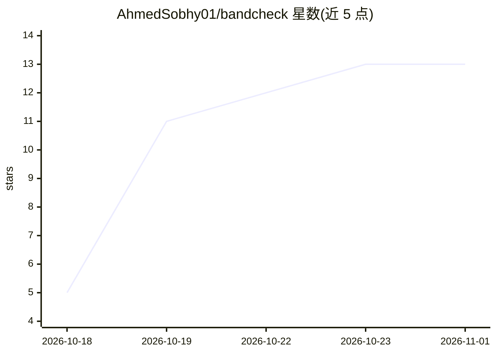

# AhmedSobhy01/bandcheck

⭐ 13 · TypeScript · MIT · 推送 2026-10-17 · [GitHub](https://github.com/AhmedSobhy01/bandcheck) · 个人维护

**IELTS 写作评分工具：上传题目截图与答案，AI 给四项评分和批改**

基于 Next.js 的 IELTS 写作批改 Web 应用：上传题目截图、粘贴答案，通过 OpenAI API（需视觉与结构化输出的模型）按公开评分标准给出四项雅思分数、逐句标注错误并给出修改与解释，另提供语言/组织分析、提升到下一档的步骤与全文改写、历史进度与学习计划。支持 Task 1 Academic/General 与 Task 2。限制：无用户账户，所有访问者可见全部答案；分数为练习估算，与 IELTS 官方无关。

## 筛选速览

| 维度 | 判定 | 备注 |
|---|---|---|
| AI 角色 | `ai-native` | 本体是模型或模型工具 |
| 许可风险 | `permissive` | MIT |
| 部署形态 | `library` | 以包/库形式分发 |
| 模型依赖 | — | README 未给出锁定关系 |
| 硬件要求 | — | 无带数字的原话,不猜 |
| 安装摩擦 | `low` | 无编译、无系统依赖或容器化 |
| 成熟度 | — | 结构信号不足 |

## 能力要点

- 四项标准评分并按 IELTS 规则四舍五入总分
- 六类错误逐条高亮标注，附修改与解释
- 错误规则名跨答案统计，生成学习计划
- 评分/语言/组织以三个并行请求完成，字数统计由代码而非模型计算

## 适用场景

- 备考雅思写作，获得练习作文的四项分数与逐句批改
- 查看自己错误的长期趋势与高频错误
- 获取提升到下一分数档的具体步骤与范文改写

## 场景标签

`AI 写作` · 领域:内容生成

## 证据(README 行号)

> L3: An IELTS Writing marker. Upload a screenshot of the question, paste your answer, and get band scores, marked
> L14: - A band for each criterion: Task Response/Achievement, Coherence and Cohesion, Lexical Resource, Grammatical
> L66: Requires Node.js 20.9+ and an OpenAI API key.

## 星数曲线

2026-10-18 5 → 2026-11-01 13（+8）

---
*卡片 v1 · prompt 1.4 · 生成 2026-10-31 · 置信度 high · 依据 README sha `0e09434d5b4d` · [字段定义](../../DATASET.md)*
