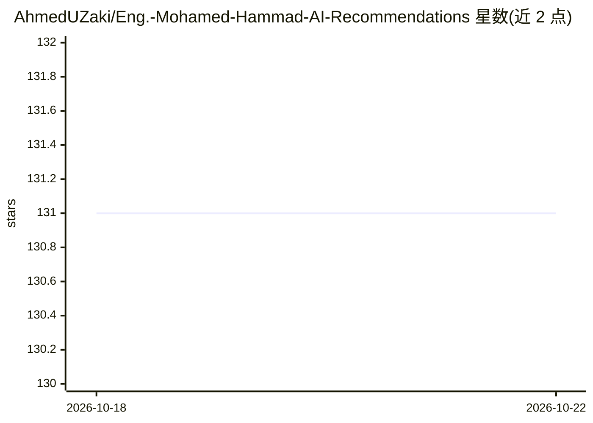

# AhmedUZaki/Eng.-Mohamed-Hammad-AI-Recommendations

⭐ 131 · 推送 2025-11-01 · [GitHub](https://github.com/AhmedUZaki/Eng.-Mohamed-Hammad-AI-Recommendations) · 个人维护

**基于 Mohamed Hammad 推荐的自学 AI/数据科学课程资源清单**

由 Ahmed UZaki 整理的资源仓库，汇集工程师 Mohamed Hammad 在社交媒体帖子中推荐的 AI、机器学习与深度学习学习资料，覆盖计算思维、数学、概率统计等前置知识及多条学习路线图（数据科学最短路径、概率机器学习、ML、AI 路线）。条目以书籍和视频教程为主，每条附推荐原帖链接，部分标注难度级别（Beginner/Intermediate/Advanced），部分书籍链接仍在逐步更新中。

## 筛选速览

| 维度 | 判定 | 备注 |
|---|---|---|
| AI 角色 | `ai-knowledge` | 知识聚合/清单类 |
| 许可风险 | `none` | — |
| 部署形态 | `None` |  |
| 模型依赖 | — | README 未给出锁定关系 |
| 硬件要求 | — | 无带数字的原话,不猜 |
| 安装摩擦 | `low` | 无编译、无系统依赖或容器化 |
| 成熟度 | — | 结构信号不足 |

## 能力要点

- 按前置知识（算法/数学/概率统计）与多条路线图组织资源
- 每条资源附推荐来源的原帖链接
- 条目标注难度级别（Beginner/Intermediate/Advanced）

## 适用场景

- 按路线图自学 AI 与数据科学
- 查找经推荐的数学与概率统计教材和课程
- 对照原帖了解资源的推荐语境

## 场景标签

`精选清单` · 领域:学习与行业

## 证据(README 行号)

> L3: Self learning **AI / Data Science** curriculum.
> L7: This repository is intended to provide **Artificial Intelligence, Machine Learning, and Deep Learning** resources ba

## 星数曲线

2026-10-18 131 → 2026-10-22 131（+0）

---
*卡片 v1 · prompt 1.4 · 生成 2026-10-22 · 置信度 high · 依据 README sha `05afcd06ba98` · [字段定义](../../DATASET.md)*
