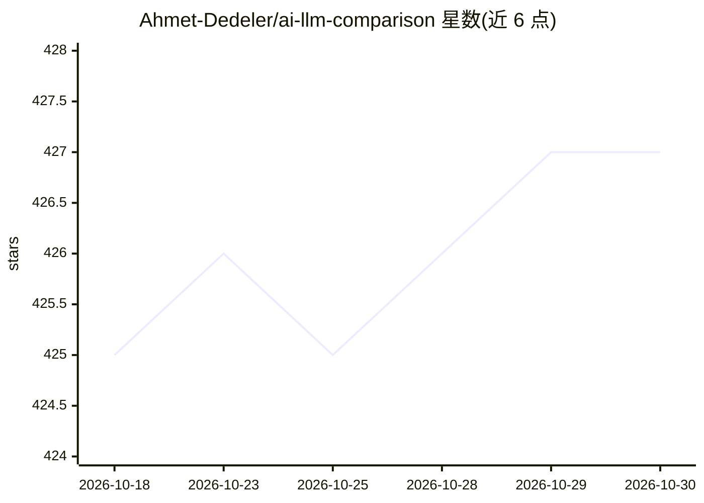

# Ahmet-Dedeler/ai-llm-comparison

⭐ 427 · TypeScript · MIT · 推送 2026-09-30 · [GitHub](https://github.com/Ahmet-Dedeler/ai-llm-comparison) · [官网](https://llmarena.ai) · 个人维护

**对比各 AI 模型价格与能力的免费开源网站**

基于 Next.js 14 的 LLM 模型对比 Web 应用：聚合 OpenAI、Anthropic、Google、Meta、Cohere 等供应商的模型信息，提供价格对比、按用量计算成本的定价计算器、双模型并排对比与实时数据更新。模型数据来自 BerriAI 的 LiteLLM 数据源。部署无需注册、免费使用，通过 git clone 与 npm 安装后以 npm run dev 在本地运行，需 Node.js 18+。

## 筛选速览

| 维度 | 判定 | 备注 |
|---|---|---|
| AI 角色 | `ai-knowledge` | 知识聚合/清单类 |
| 许可风险 | `permissive` | MIT |
| 部署形态 | `library` | 以包/库形式分发 |
| 模型依赖 | — | README 未给出锁定关系 |
| 硬件要求 | — | 无带数字的原话,不猜 |
| 安装摩擦 | `low` | 无编译、无系统依赖或容器化 |
| 成熟度 | — | 结构信号不足 |

## 能力要点

- 跨供应商（OpenAI/Anthropic/Google/Meta/Cohere 等）模型价格对比
- 按使用量计算成本的定价计算器
- 模型并排 Versus 对比
- 模型数据来自 BerriAI LiteLLM 数据源

## 适用场景

- 选择应用开发中性价比合适的 AI 模型
- 对比不同供应商的 API 定价
- 了解各模型规格与价格趋势

## 场景标签

 · 领域:AI 模型信息/对比工具

## 证据(README 行号)

> L7: A comprehensive, free, and open-source tool to compare AI language models (LLMs) from different providers including 
> L68: Model data is fetched from BerriAI's LiteLLM, ensuring accurate and up-to-date information about AI model pricing a

## 星数曲线

2026-10-18 425 → 2026-10-30 427（+2）

---
*卡片 v1 · prompt 1.4 · 生成 2026-10-21 · 置信度 high · 依据 README sha `ca5d5013583c` · [字段定义](../../DATASET.md)*
