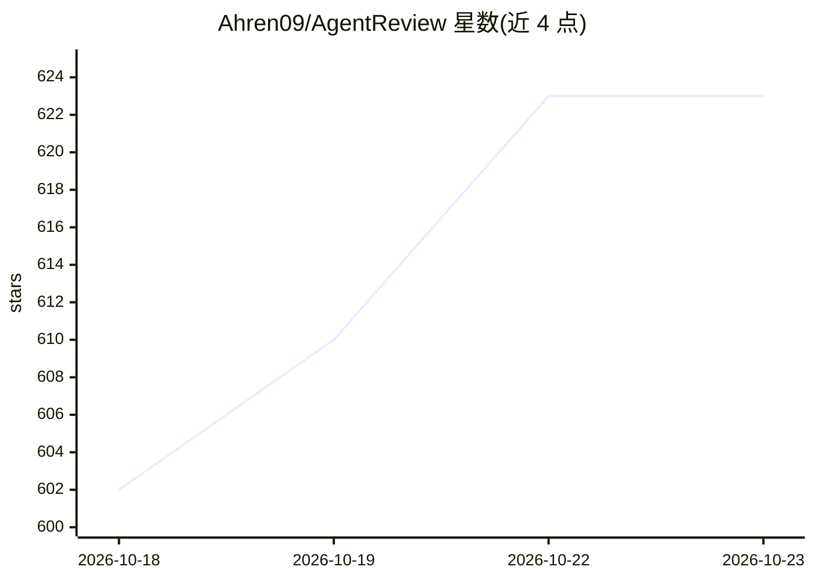

# Ahren09/AgentReview

⭐ 623 · Jupyter Notebook · Apache-2.0 · 推送 2026-05-10 · [GitHub](https://github.com/Ahren09/AgentReview) · [官网](https://agentreview.github.io/) · 组织维护

**用 LLM Agent 模拟学术同行评审的研究框架**

EMNLP 2024 论文的官方实现：将论文评审建模为五阶段流水线（评审评估、作者答辩、评审-AC 讨论、元评审、录用决策），评审、作者、领域主席三种角色各由可配置潜在特质的 LLM Agent 扮演。通过每次只改变一个特质并与基线对照，分离评审承诺度、意图、知识性、AC 风格与作者匿名性等因素的影响，已生成 53,800+ 份评审文档。运行需 OpenAI 或 Azure OpenAI API key，支持 Linux/macOS/WSL，数据集托管于 Dropbox。

## 筛选速览

| 维度 | 判定 | 备注 |
|---|---|---|
| AI 角色 | `ai-native` | 本体是模型或模型工具 |
| 许可风险 | `permissive` | Apache-2.0 |
| 部署形态 | `library` | 以包/库形式分发 |
| 模型依赖 | locked-api |  |
| 硬件要求 | — | 无带数字的原话,不猜 |
| 安装摩擦 | `low` | 无编译、无系统依赖或容器化 |
| 成熟度 | — | 结构信号不足 |

## 能力要点

- 五阶段流水线与三种 LLM Agent 角色的评审模拟
- 评审/作者/AC 特质轴可配置，单变量对照分离潜在因素
- 已产出 53,800+ 份评审文档，覆盖 ICLR 2020–2023 共 523 篇投稿
- 可在 experiment_config.py 中注册自定义实验设置

## 适用场景

- 研究评审偏见、社会影响等社会学现象对评审结果的影响
- 以模拟替代敏感的真实评审数据做隐私安全的分析
- 复现论文实验或自定义评审设定进行探索

## 场景标签

`科研工具` `多智能体` · 领域:Agent 开发

## 证据(README 行号)

> L3:  The first LLM-agent simulation of the academic peer review process.
> L54: AgentReview models peer review as a structured **five-phase pipeline** with three role types — *reviewers*, *author

## 星数曲线

2026-10-18 602 → 2026-10-23 623（+21）

---
*卡片 v1 · prompt 1.4 · 生成 2026-10-21 · 置信度 mid · 依据 README sha `bd2161abbeba` · [字段定义](../../DATASET.md)*
