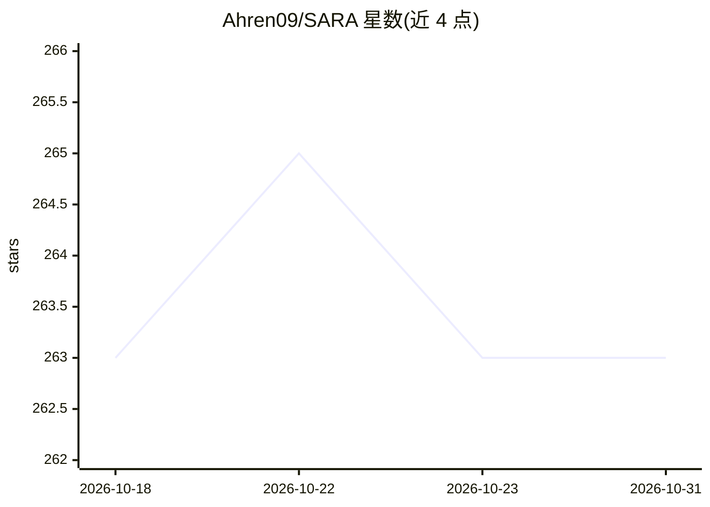

# Ahren09/SARA

⭐ 263 · Python · Apache-2.0 · 推送 2026-07-23 · [GitHub](https://github.com/Ahren09/SARA) · [官网](https://ahren09.github.io/SARA/) · 组织维护

**论文官方实现：RAG 上下文压缩方法 SARA，k 条文本+n−k 压缩嵌入**

ACL 2026 论文 SARA 的官方实现（Georgia Tech 与 Visa Research 合作）。将检索证据表示为 k 条自然语言段落加 n−k 个压缩检索嵌入，通过训练的小型 projector 把检索器嵌入映射到语言模型隐藏空间并注入 <COMPRESS> token 位置，在固定上下文预算内覆盖更多文档。仓库仅支持两种评测方法：Standard RAG 与 SARA，均基于公开 Mistral-7B-Instruct-v0.2、LoRA 训练、BM25 检索、QASPER 基准，提供单一 CLI（finetune/evaluate/report）。限定 Python 3.11 + CUDA 12.x 环境。

## 筛选速览

| 维度 | 判定 | 备注 |
|---|---|---|
| AI 角色 | `ai-native` | 本体是模型或模型工具 |
| 许可风险 | `permissive` | Apache-2.0 |
| 部署形态 | `None` |  |
| 模型依赖 | — | README 未给出锁定关系 |
| 硬件要求 | — | 无带数字的原话,不猜 |
| 安装摩擦 | `medium` | 含编译或系统依赖之一 |
| 成熟度 | — | 结构信号不足 |

## 能力要点

- projector 将检索器嵌入映射到 LM 隐藏空间并注入 <COMPRESS> 位置
- Standard RAG 与 SARA 同数据/检索器/解码/种子的对照实验
- LoRA 优先：仅保存 adapter 与 projector，不保存完整模型
- 单一 CLI 覆盖 finetune/evaluate/report，含批量生成与评测

## 适用场景

- 复现论文中 SARA 与 Standard RAG 的对比实验
- 在固定上下文预算内让模型参考更多检索文档
- 基于代码研究检索嵌入压缩与 projector 对齐方法

## 场景标签

`RAG` `微调` · 领域:知识与检索

## 证据(README 行号)

> L33: **SARA** represents retrieved evidence as a mix of **`k` natural-language passages** and **`n − k` compressed
> L44: Both start from the **public** `mistralai/Mistral-7B-Instruct-v0.2` base and are trained with matched budgets,

## 星数曲线

2026-10-18 263 → 2026-10-31 263（+0）

---
*卡片 v1 · prompt 1.4 · 生成 2026-10-22 · 置信度 high · 依据 README sha `6f8f250ea82b` · [字段定义](../../DATASET.md)*
