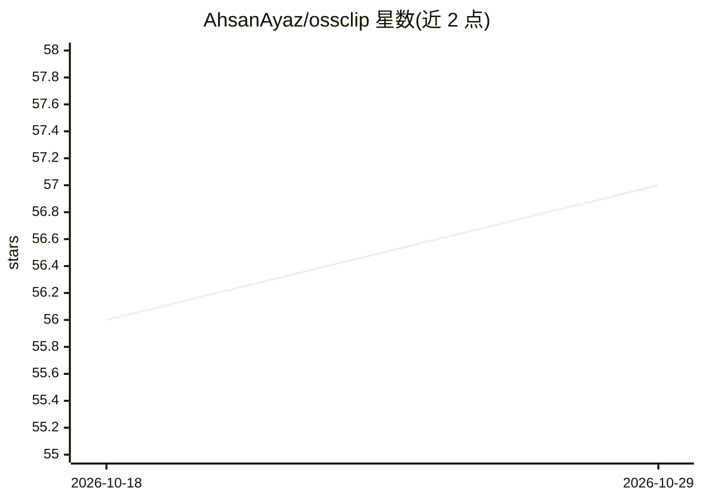

# AhsanAyaz/ossclip

⭐ 57 · TypeScript · NOASSERTION · 推送 2026-09-29 · [GitHub](https://github.com/AhsanAyaz/ossclip) · [官网](https://ahsanayaz.github.io/ossclip/) · 个人维护

**本地优先的 CLI 短视频制作工具：去静音、逐词字幕、LLM 规划图形**

面向口播视频创作者的命令行工具：用本地 whisper.cpp 转录，自动剪辑静音、语气词与重录片段，生成逐词时间轴字幕，按检测到的人脸做构图，并由 LLM 依据实际说了什么来规划九种代码渲染的屏幕图形（标题卡、统计卡、图表、终端/聊天模拟）。渲染用本地 Remotion，仅 LLM 规划与自托管的 publish 上传走网络。自称 pre-1.0，多片段剪辑尚未支持。支持 npm 全局安装与一键 setup 下载 ffmpeg/whisper 依赖。

## 筛选速览

| 维度 | 判定 | 备注 |
|---|---|---|
| AI 角色 | `ai-native` | 本体是模型或模型工具 |
| 许可风险 | `none` | NOASSERTION |
| 部署形态 | `library` | 以包/库形式分发 |
| 模型依赖 | locked-api |  |
| 硬件要求 | — | 无带数字的原话,不猜 |
| 安装摩擦 | `medium` | 含编译或系统依赖之一 |
| 成熟度 | `idea` | |

## 能力要点

- 本地 whisper.cpp 转录 + 本地 Remotion 渲染，仅 LLM 规划走网络
- 九种 Zod 类型化场景组件，LLM 计划经 schema 校验后渲染
- LLM 通道可用自有 Claude Code 订阅或自备 API key，剪辑+字幕完全无 key 可用
- 自带网页编辑器：时间轴、切分、逐项恢复被剪内容、调色与音效轨

## 适用场景

- 把录好的口播素材自动剪成带字幕和图形的竖屏短视频
- 对已产出的视频做手动精修（时间轴编辑、恢复误剪、调色）
- 非英语素材（如乌尔都语）做 RTL 逐词字幕

## 场景标签

`图像视频处理` · 领域:感知与多模态

## 证据(README 行号)

> L11: **A local-first CLI that turns a talking-head take into a finished short.** It cuts silence and filler words, write
> L32: Setup also offers to save an LLM key for `--produce` (the graphics planner): a logged-in Google Antigravity (`agy`)

## 星数曲线

2026-10-18 56 → 2026-10-29 57（+1）

---
*卡片 v1 · prompt 1.4 · 生成 2026-10-24 · 置信度 high · 依据 README sha `3bab813fa11b` · [字段定义](../../DATASET.md)*
