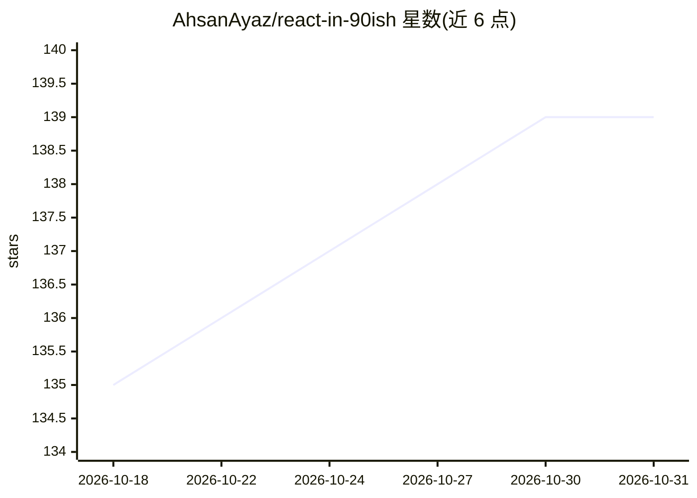

# AhsanAyaz/react-in-90ish

⭐ 139 · HTML · 推送 2025-12-05 · [GitHub](https://github.com/AhsanAyaz/react-in-90ish) · [官网](https://ahsanayaz.github.io/react-in-90ish/) · 个人维护

**90 分钟 React 速成教程，含视频与全栈实战项目**

React 19 速成课程仓库：包含讲解幻灯片、YouTube 视频教程与动手实战教程。实战项目为 PokAImon Generator——基于 Vite+React 19 前端、Express+PostgreSQL 后端的 AI 生物生成应用，覆盖画布绘制、画廊、点赞与暗色模式；AI 生成依赖可选配置的 Gemini API key，未配置时使用模拟占位生成。另提供 StackBlitz 浏览器内示例。

## 筛选速览

| 维度 | 判定 | 备注 |
|---|---|---|
| AI 角色 | `ai-knowledge` | 知识聚合/清单类 |
| 许可风险 | `none` | — |
| 部署形态 | `self-host` | docker 或自建部署 |
| 模型依赖 | — | README 未给出锁定关系 |
| 硬件要求 | — | 无带数字的原话,不猜 |
| 安装摩擦 | `low` | 无编译、无系统依赖或容器化 |
| 成熟度 | — | 结构信号不足 |

## 能力要点

- 幻灯片+视频+分步教程文档三种形态
- 实战项目含前后端与 docker compose 数据库初始化
- AI 生物生成为可选功能（Gemini API，缺省走占位生成）

## 适用场景

- 跟随 90 分钟速成课入门 React 19 与现代模式
- 在浏览器中通过 StackBlitz 试运行示例
- 按教程从零搭建一个含 AI 生成功能的全栈应用

## 场景标签

`教程课程` · 领域:学习与行业

## 证据(README 行号)

> L3: Welcome to **React in 90-ish Minutes** - a 90 minutes crash course on ReactJS, including explanatory slides, a YouTu
> L35: **PokAImon Generator** - An AI-powered creature creator app with:
> L171: ## 🤖 AI Integration (Optional)

## 星数曲线

2026-10-18 135 → 2026-10-31 139（+4）

---
*卡片 v1 · prompt 1.4 · 生成 2026-10-22 · 置信度 high · 依据 README sha `d2fb021833b5` · [字段定义](../../DATASET.md)*
