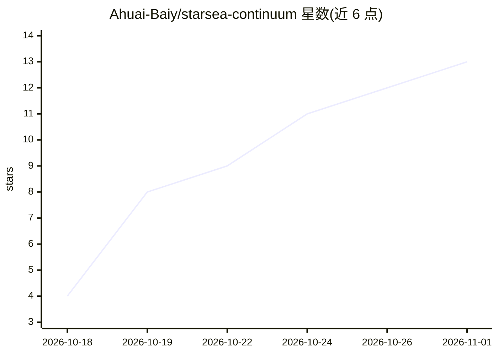

# Ahuai-Baiy/starsea-continuum

⭐ 13 · Python · Apache-2.0 · 推送 2026-10-17 · [GitHub](https://github.com/Ahuai-Baiy/starsea-continuum) · 组织维护

**判定 AI 会话线程能否安全继续的确定性规划器**

面向构建 AI 对话应用的开发者的线程连续性规划器：应用在每轮对话前提供仅含元数据（id、版本、摘要）的轮次描述，库返回 resume/catchup/rebuild/new/ephemeral 五种决策及理由码，覆盖消息编辑、模型/渠道切换、事实变更等 35 条规则；v0.5 起提供 assemble_fresh_context() 组装新线程上下文并报告排除项。纯函数实现：无网络、无模型调用、零依赖，同输入同输出。当前为早期公开预览 v0.5.0，checkpoint 验证等能力仅为设计文档。

## 筛选速览

| 维度 | 判定 | 备注 |
|---|---|---|
| AI 角色 | `ai-ecosystem` | LLM/agent 周边工具 |
| 许可风险 | `permissive` | Apache-2.0 |
| 部署形态 | `library` | 以包/库形式分发 |
| 模型依赖 | — | README 未给出锁定关系 |
| 硬件要求 | — | 无带数字的原话,不猜 |
| 安装摩擦 | `low` | 无编译、无系统依赖或容器化 |
| 成熟度 | `idea` | |

## 能力要点

- 五决策（resume/catchup/rebuild/new/ephemeral）+ 35 条规则与理由码
- assemble_fresh_context() 组装新线程上下文并列出排除原因
- 纯函数、零依赖、无网络/模型调用，输出确定性
- plan_event()/summarize() 输出仅元数据的观测与 resume 率统计

## 适用场景

- 多模型/多渠道切换的对话应用判断旧线程是否可续
- 消息被编辑或重新生成后决定重建线程的时机
- 新线程组装时排除半途回复与过期摘要

## 场景标签

 · 领域:LLM 基础设施/会话管理

## 证据(README 行号)

> L72: Before each turn, your app gives Continuum a small description of the turn —
> L84: It is a pure function: no network, no files, no database, no model calls, no

## 星数曲线

2026-10-18 4 → 2026-11-01 13（+9）

---
*卡片 v1 · prompt 1.4 · 生成 2026-10-31 · 置信度 mid · 依据 README sha `093b66de88af` · [字段定义](../../DATASET.md)*
