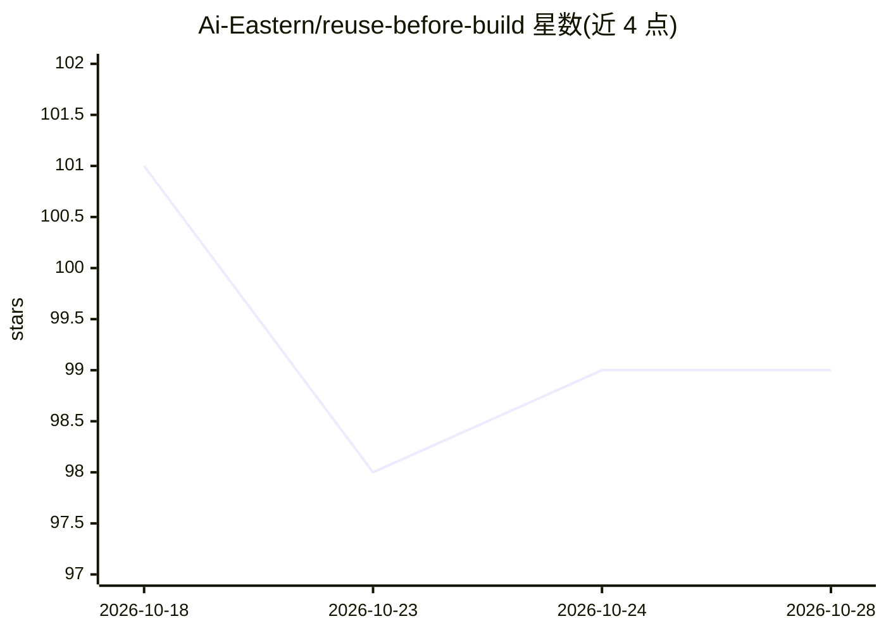

# Ai-Eastern/reuse-before-build

⭐ 99 · Python · MIT · 推送 2026-10-11 · [GitHub](https://github.com/Ai-Eastern/reuse-before-build) · 个人维护 · 中文 README

**约束编程 Agent 先复用既有代码再新建的 Agent Skill**

一个 SKILL.md 格式的指令式 Agent Skill：让 Claude Code、Codex 等支持 Agent Skills 的编程代理在写新代码前先搜索项目、标准库与已安装依赖，仅在存在真实缺口时查 GitHub 与官方源，随后按 Take（直接用）/Borrow（改造）/Build（只补缺失部分）做决策并引用实际读过的文件。无服务、无运行时依赖，行为依赖宿主与模型，不带工具或强制机制，也不保证降低成本。通过复制文件夹或 npx skills CLI 安装。

## 筛选速览

| 维度 | 判定 | 备注 |
|---|---|---|
| AI 角色 | `ai-ecosystem` | LLM/agent 周边工具 |
| 许可风险 | `permissive` | MIT |
| 部署形态 | `library` | 以包/库形式分发 |
| 模型依赖 | locked-api |  |
| 硬件要求 | — | 无带数字的原话,不猜 |
| 安装摩擦 | `low` | 无编译、无系统依赖或容器化 |
| 成熟度 | — | 结构信号不足 |

## 能力要点

- Take/Borrow/Build/Blocked/需人工批准 五种决策路径
- 本地优先搜索：仅真实缺口才检索外部源
- 引入外部库前钉版本并读清单、许可、实现与测试
- 无服务、无运行时依赖，纯指令式工作流

## 适用场景

- 让编程 Agent 实现功能前先复用项目内已有的代码与测试
- 选库或选框架时让 Agent 读源码与许可再决定
- 接手他人交接的任务时核验已有测试与结论

## 场景标签

`提示工程` · 领域:Agent 开发

## 证据(README 行号)

> L9:  An Agent Skill that makes your coding agent look for existing code, tests, and libraries to reuse before it writes 
> L10:  For Claude Code, Codex, and other agents that support Agent Skills · No service · No runtime dependency
> L6:  Agent Skills format: SKILL.md

## 星数曲线

2026-10-18 101 → 2026-10-28 99（-2）

---
*卡片 v1 · prompt 1.4 · 生成 2026-10-23 · 置信度 high · 依据 README sha `fbfd362c25ff` · [字段定义](../../DATASET.md)*
