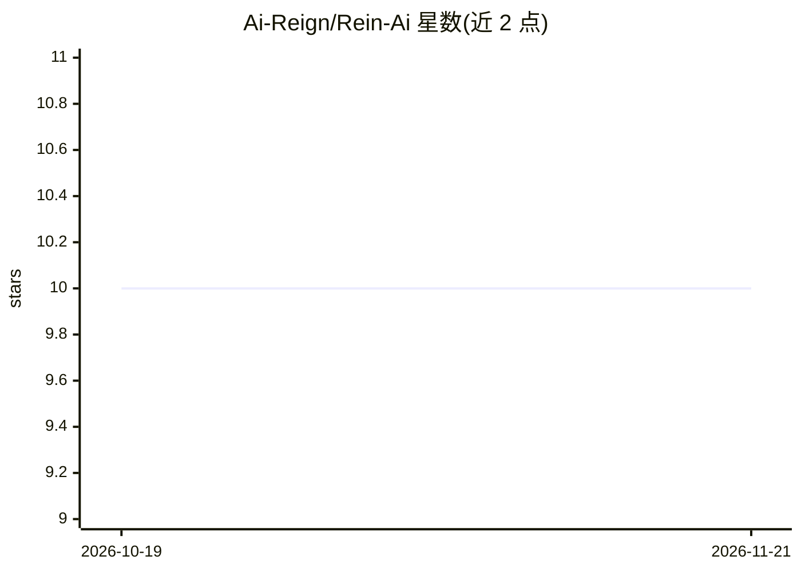

# Ai-Reign/Rein-Ai

⭐ 10 · Python · AGPL-3.0 · 推送 2026-05-14 · [GitHub](https://github.com/Ai-Reign/Rein-Ai) · [官网](https://reinai.io) · 个人维护

**给自主 AI Agent 加运行时熔断开关的治理库**

内嵌于 Agent 执行链路的 Python 库：对每个动作按来源与类型做贝叶斯衰减评分，依据实时信号划分 normal/stressed/shock 三种运行状态，当回撤、错误率、限流风暴或异常检测触发阈值时熔断系统，并以 JSONL 加密链写入防篡改审计日志。提供自然语言策略编译器（英文规则转可执行配置）与内置红队对抗模拟器（五种攻击类）。一个装饰器即可接入，兼容 LangChain、LlamaIndex、OpenAI Agents SDK；AGPL-3.0 许可，商业用途需 Pro 版豁免。

## 筛选速览

| 维度 | 判定 | 备注 |
|---|---|---|
| AI 角色 | `ai-ecosystem` | LLM/agent 周边工具 |
| 许可风险 | `dual` | AGPL-3.0 |
| 部署形态 | `library` | 以包/库形式分发 |
| 模型依赖 | locked-api |  |
| 硬件要求 | — | 无带数字的原话,不猜 |
| 安装摩擦 | `low` | 无编译、无系统依赖或容器化 |
| 成熟度 | — | 结构信号不足 |

## 能力要点

- 一个装饰器治理任意异步函数，框架无关
- 自然语言策略编译为可执行规则
- 内置对抗红队模拟器（五种攻击类）
- 防篡改 JSONL 加密链审计日志

## 适用场景

- 防止交易/邮件类 Agent 失控持续执行
- 上线前对 Agent 策略做对抗性攻击测试
- 为 Agent 决策提供合规审计日志

## 场景标签

`LLM 可观测性` · 领域:评测与运维

## 证据(README 行号)

> L3: **Runtime kill-switch for autonomous AI agents.** Rein gates every action your agent takes, scores it against live p
> L17: One decorator. Framework-agnostic — works with LangChain, LlamaIndex, OpenAI Agents SDK, or your own loop.
> L29: Existing AI safety tooling validates **content**. Guardrail libraries check whether an LLM's input or output contai

## 星数曲线

2026-10-19 10 → 2026-11-21 10（+0）

---
*卡片 v1 · prompt 1.4 · 生成 2026-11-20 · 置信度 high · 依据 README sha `8750191d689c` · [字段定义](../../DATASET.md)*
