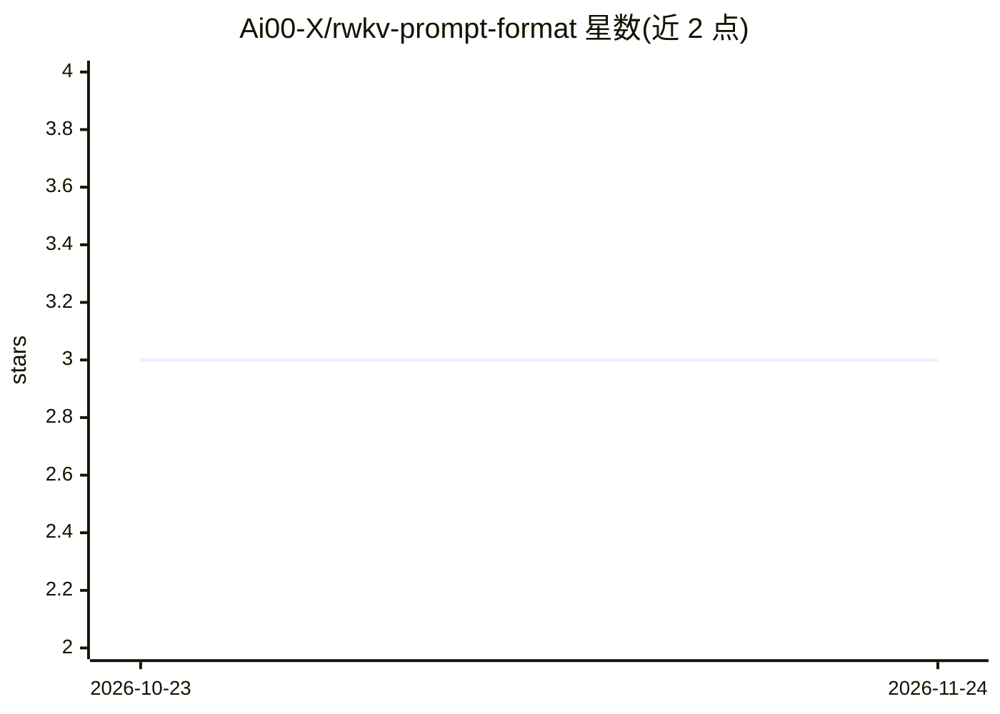

# Ai00-X/rwkv-prompt-format

⭐ 3 · Rust · Apache-2.0 · 推送 2026-10-22 · [GitHub](https://github.com/Ai00-X/rwkv-prompt-format) · 组织维护 · 中文 README

**RWKV G1/G1x 提示词格式的校验与自动修复工具**

面向使用 RWKV G1/G1x 模型的开发者，校验提示词是否符合官方模板（块分隔、大小写敏感标签、生成点位置等）并自动修复，规则来自官方模板文件。提供 JSON CLI、C ABI 动态库、Python/Node/Go/Java/C# 绑定、WASM 模块、MCP server 与 agent skill 六种使用形态；与推理运行时解耦，不加载模型、不触碰 GPU、不读写文件。修复过程确定性且幂等，仅保证语法匹配模板，不做语义改写。

## 筛选速览

| 维度 | 判定 | 备注 |
|---|---|---|
| AI 角色 | `ai-ecosystem` | LLM/agent 周边工具 |
| 许可风险 | `permissive` | Apache-2.0 |
| 部署形态 | `desktop` | 安装包/桌面程序 |
| 模型依赖 | — | README 未给出锁定关系 |
| 硬件要求 | — | 无带数字的原话,不猜 |
| 安装摩擦 | `medium` | 含编译或系统依赖之一 |
| 成熟度 | — | 结构信号不足 |

## 能力要点

- 六种使用形态：CLI、C ABI、多语言绑定、WASM、MCP、agent skill
- 修复规则来自官方模板文件（BlinkDL/RWKV-LM）
- 确定性且幂等（fix(fix(x)) == fix(x)），每条转换路径有测试覆盖
- 支持 ChatML、Llama 3、JSONL、Markdown 等格式到 G1 plain 的结构转换

## 适用场景

- CI 流程中校验 RWKV 提示词模板是否合规
- 将 ChatML/JSONL 等对话记录转换为 RWKV G1 格式
- 让 AI agent 通过 MCP server 或 skill 调用格式检查

## 场景标签

`提示工程` · 领域:Agent 开发

## 证据(README 行号)

> L11: A **format checker and auto-fixer for RWKV G1/G1x prompts**. It is independent of the
> L21: |MCP|Qoder, Claude Desktop, and other AI agents|`mcp/server.mjs` (zero-dependency stdio)|

## 星数曲线

2026-10-23 3 → 2026-11-24 3（+0）

---
*卡片 v1 · prompt 1.4 · 生成 2026-11-22 · 置信度 mid · 依据 README sha `bc43e9a60ebd` · [字段定义](../../DATASET.md)*
