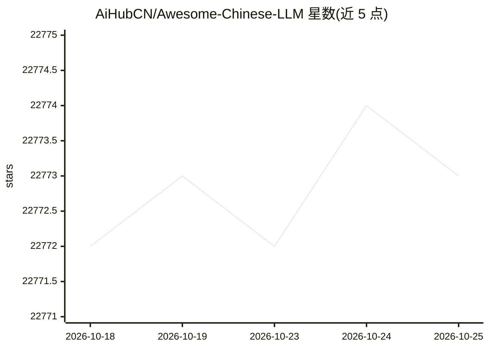

# AiHubCN/Awesome-Chinese-LLM

⭐ 22,773 · 推送 2026-05-10 · [GitHub](https://github.com/AiHubCN/Awesome-Chinese-LLM) · 个人维护 · 中文 README

**中文开源大语言模型资源清单：收录模型、应用、数据集与教程**

收集和梳理中文 LLM 相关开源资料的 awesome 清单，收录资源达 100+ 个，以规模较小、可私有化部署、训练成本较低的模型为主。内容组织为底座模型概览表（含参数量、训练 token 数、上下文长度、可商用性）、文本 LLM 模型条目、垂直领域微调及应用、数据集与教程等类别；每个模型条目提供仓库地址与简介，欢迎社区通过 PR 贡献新条目。

## 筛选速览

| 维度 | 判定 | 备注 |
|---|---|---|
| AI 角色 | `ai-knowledge` | 知识聚合/清单类 |
| 许可风险 | `none` | — |
| 部署形态 | `None` |  |
| 模型依赖 | — | README 未给出锁定关系 |
| 硬件要求 | — | 无带数字的原话,不猜 |
| 安装摩擦 | `low` | 无编译、无系统依赖或容器化 |
| 成熟度 | — | 结构信号不足 |

## 动量与使用信号

- 维护:`maintenance` — 距上次 push 161.1 天,年发版 0,27 位贡献者
- 涨星:近 1 天 **+0**(自 20261016 起算)
- 安装:github 包 `release-assets` 月下载无数据
- 平台:— · 协议:OPENAI-API

## 能力要点

- 提供常见底座模型细节概览表（参数、token 数、最大长度、商用许可）
- 收录 100+ 个中文 LLM 相关开源模型、应用、数据集与教程
- 以规模较小、可私有化部署、训练成本较低的模型为收录重点

## 适用场景

- 查找可私有化部署的小规模中文大模型
- 对比各底座模型的参数规模与商用许可情况
- 寻找中文 LLM 的微调数据集与教程

## 场景标签

`精选清单` · 领域:学习与行业

## 证据(README 行号)

> L13: 自ChatGPT为代表的大语言模型（Large Language Model, LLM）出现以后，由于其惊人的类通用人工智能（AGI）的能力，掀起了新一轮自然语言处理领域的研究和应用的浪潮。尤其是以ChatGLM、LLaMA等平民
> L37: ## 目录
> L21: 常见底座模型细节概览：

## 星数曲线

2026-10-18 22,772 → 2026-10-25 22,773（+1）

---
*卡片 v1 · prompt 1.4 · 生成 2026-10-18 · 置信度 high · 依据 README sha `75c55f18090c` · [字段定义](../../DATASET.md)*
